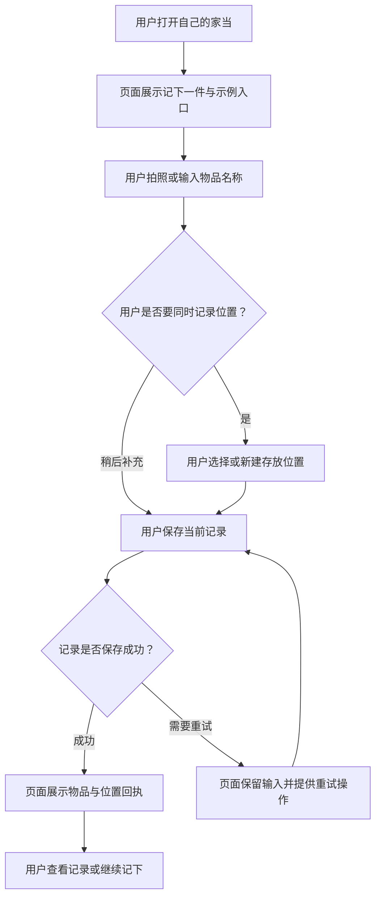
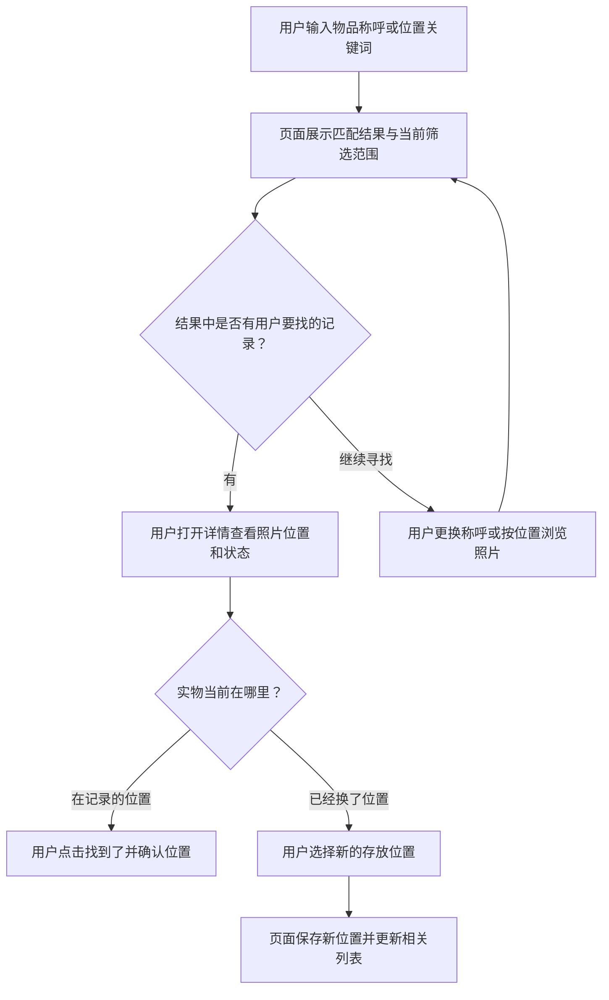
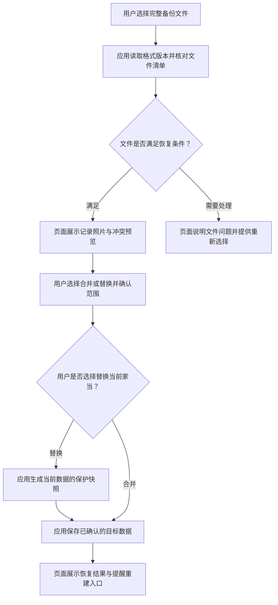

# 信息架构与关键流程

版本：1.1 · 2026-11-01。关联需求 F01—F18。

## 1. 用户能够在哪里找到什么

| 一级入口 | 主要内容 | 二级去向 |
| --- | --- | --- |
| 家当 P01 | 搜索、筛选、最近记录、常用、继续草稿 | 搜索 P02、详情 P05、批量整理 P10 |
| 位置 P07 | 自己命名的位置树、当前层物品概况 | 位置详情 P08、新建位置 P09 |
| 我的 P11 | 提醒、常用、历史、数据与偏好 | P12—P15、帮助 P19 |
| 记下操作 | 从任一一级页面开始记录 | 记录面板 P03、位置选择 P04 |

“记下”是跨页操作。用户关闭面板后回到原来的页签和滚动位置。搜索、详情、编辑和数据管理属于下一级页面，顶部具有明确的返回入口。

## 2. 页面目录

| 编号 | 页面或界面 | 所属层级 |
| --- | --- | --- |
| P01 | 家当：空状态、记录列表、常用与筛选 | 一级 |
| P02 | 搜索：输入、结果、结果为空 | 二级 |
| P03 | 记下：单件、整组、连续、保存回执 | 半模态面板 |
| P04 | 选择位置：最近、层级、搜索 | 半模态面板 |
| P05 | 物品详情：照片、位置、状态、更新操作 | 二级 |
| P06 | 编辑物品：完整字段、数量与日期 | 三级 |
| P07 | 位置：根位置列表 | 一级 |
| P08 | 位置详情：子位置、记录、在这里记下 | 二级，可逐层进入 |
| P09 | 新建或编辑位置 | 半模态面板 |
| P10 | 批量整理 | 二级的选择模式 |
| P11 | 我的 | 一级 |
| P12 | 提醒：列表、日期设置、日历状态 | 二级与设置面板 |
| P13 | 数据管理：导出、完整备份、恢复预览 | 二级 |
| P14 | 历史：归档、回收站、恢复与永久删除 | 二级 |
| P15 | 外观与隐私 | 二级 |
| P16 | 接收图片：选择记录方式、确认保存 | 外部入口页 |
| P17 | 图片查看与文字候选 | 全屏预览与局部面板 |
| P18 | 桌面卡片：通用入口、用户开启的摘要 | 系统桌面 |
| P19 | 帮助与关于：记录方法、数据说明、版本 | 二级 |
| P20 | 到期日期：直接填日期或保质期计算 | P03、P06 的内嵌表单区 |
| P21 | 到期提醒：开启状态、通知内容隐私与安排结果 | 二级设置面板 |
| P22 | 扫码查同款：扫码、结果、新建 | 系统扫码与应用结果页 |
| P23 | 语音填写：录音、候选、确认 | 半模态面板 |

## 3. J01：第一次记下并获得价值

该流程以“一条能帮助用户的记录”结束。系统拍照和相册选择返回后继续原草稿；用户退出时，草稿保存到本地。

## 4. J02：整理同一个位置

用户进入 P08 → 点击“在这里记下” → P03 显示当前完整位置 → 保存第一条 → 点击“继续记下” → 记录第二条 → 点击“完成这次整理” → 返回 P08，看见本次新增记录。

记录类型可以在每次保存前切换。会话内位置条保持可见；切换位置后，下一条采用新位置。会话摘要按实际成功保存的记录计算。

## 5. J03：找东西与购买前确认

购买前的查询在 P02 完成：在手数量和借出状态直接出现。进入详情返回后保留查询词、筛选器和滚动位置。

## 6. J04：位置与批量移动

单件：P05“改位置” → P04 选择目标 → 显示新路径 → 保存 → 返回 P05。

多件：P01 或 P08 长按记录进入 P10 → 选择记录 → “移位置” → P04 → 确认数量与目标路径 → 保存 → 返回原列表并重算筛选结果。

整个位置：P08“管理位置” → 选择新父位置 → 校验层级与同名 → 展示影响的子位置和记录数量 → 保存 → 返回新路径下的 P08。

## 7. J05：借出、归还与归档

借出：P05“更多”中的“借出” → 填对方称呼与可选归还日期 → 保存 → 详情显示借出状态。

归还：P05“已归还” → 选择放回位置 → 保存 → 详情显示在手状态，归还日期转为已处理。

归档：P05“更多”中的“归档” → 选择原因 → 保存 → 回到原列表；P14 可查看和恢复。恢复用完记录时，先确认当前数量。

## 8. J06：录入日期后，到期提醒

用户录入物品 → 填到期日期，或填生产日期与保质期 → 表单显示到期日 → 保存物品与日期 → 沿用已开启的到期提醒 → 系统在到期当天 09:00 发出一次汇总提醒 → 用户点开查看、修改或处理。

首次保存日期时提供一次“开启到期提醒”说明，按实际承载方式申请通知或日历授权。授权成功后登记未来日期；用户保留当前权限时，日期仍保存并在 P12 显示。缺少生产日期时保留已填期限，提示补上起点；物品照常保存。

## 9. J07：备份与恢复

完整规则见 `10`。清单 CSV 用于阅读和整理；`.itemnest` 用于完整恢复。

## 10. J08：从图库分享已有照片

系统图库选择图片 → 系统分享选择“我的家当” → P16 读取临时授权内容并生成导入会话 → 用户选择“每张记一件 / 合成一组”、名称和位置 → 保存 → 展示实际生成的记录与返回原应用入口。

原有草稿保留在自己的会话中。暂存照片完成复制后才能计入可保存内容。用户取消导入时回到来源应用，当前导入可通过应用内草稿入口继续。

## 11. 通用返回与任务恢复规则

1. 键盘展开时，第一次系统返回收起键盘；随后返回关闭当前选择面板或退出当前页面。
2. P04、P09 关闭后回到原草稿，保留已输入信息；只有明确选择才改变位置。
3. P03、P06 有变更时，返回先保存本地草稿，再回原页面；页面给出“已保留草稿”。正式物品由“保存”操作更新。
4. 标签切换保留各一级页面的筛选、滚动位置和选择上下文，批量选择结束后再切换。
5. 卡片或分享带入的记录已经变化时，读取最新记录；回收站记录打开回收站详情，永久删除记录显示“这条记录已移除”，提供家当入口。
6. 应用重新打开时恢复最近一级页；外部入口优先处理本次明确目的，再提供回到家当的路径。

## 12. 文案对应的动作

“记下”开始记录；“保存”提交当前内容；“继续记下”开启下一条；“找到了”由用户确认实物位置；“归档”把记录移入历史；“移入回收站”保留 30 天恢复机会；“永久删除”完成最终清理。相同动作在全部页面使用同一名称。

## 13. J09：扫码查同款

用户在搜索中选择扫一扫 → 系统默认扫码界面返回码值 → 应用查询本地同码记录 → 用户查看已有数量、位置和日期，或选择再记同款 → 新草稿带入名称、分类、条码 → 用户补充本次内容并保存。首次码值进入带条码的新建草稿。

## 14. J10：语音填写当前字段

用户在名称、说明或搜索旁点语音 → 首次按需授权麦克风 → 说出内容并停止 → 查看可编辑候选 → 采用文字 → 回到原字段继续任务。取消、切后台或关闭面板结束本次录音；输入框保留原有内容。
