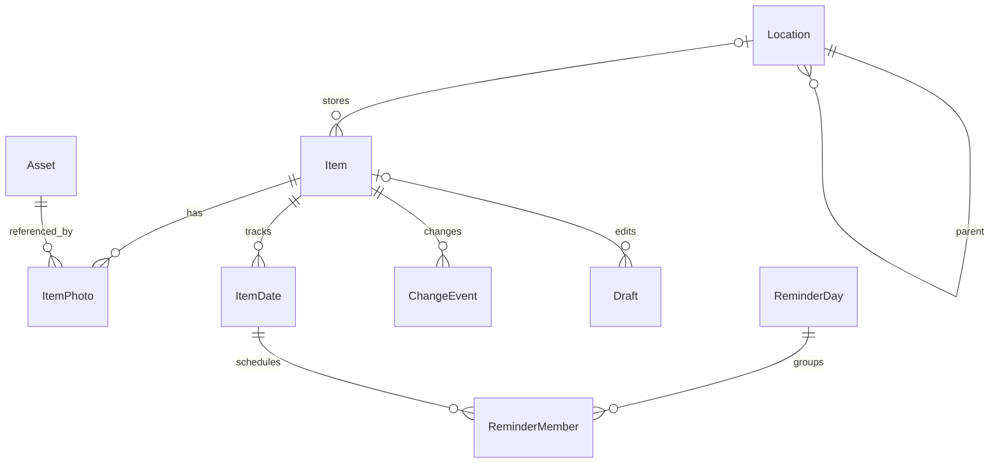

# 数据模型与业务规则

版本：1.1 · 2026-11-01。本文定义正式数据的唯一业务口径。字段采用英文标识，页面名称沿用 `05`。

## 1. 用户看到的数量

“记录”是可独立查找和维护的对象。“单件记录”可以表示同种物品的若干件；“整组记录”表示用户划定的一组物品。

| 指标 | 计算范围 |
| --- | --- |
| 当前单件记录 | `kind=SINGLE`、状态在手或借出、`deletedAt=null` 的条数 |
| 当前整组记录 | `kind=GROUP`、状态在手或借出、`deletedAt=null` 的组数 |
| 在手单件数量 | `kind=SINGLE`、`status=ACTIVE`、`deletedAt=null` 的 quantity 合计 |
| 某位置记录 | 按当前“这里 / 包含子位置”范围统计当前单件记录条数与整组记录组数 |
| 搜索结果 | 当前范围内满足全部关键词及筛选条件的记录条数 |

各口径在 UI 中写明“条、组、件”。整组的数量由组的定义表达，组内实际件数由用户说明。

## 2. 基础约定

- 实体 ID 使用随机 UUID；导出和导入保留 ID。时间戳为 UTC 毫秒，页面按当前时区显示。
- 业务日期使用 `YYYY-MM-DD`，表达当地日历日期；提醒时刻结合当前时区计算。
- 字符限制按 Unicode 码点计算；文本先去除首尾空白，保留用户正文中的换行。
- 每次正式变更递增 `revision`，更新 `updatedAt`，并追加相应的变化记录。查看行为单独更新 `lastViewedAt`。
- 新建、批量保存和恢复使用 `operationId` 作为动作标识；同一标识返回同一提交结果。
- 关系型数据与照片引用在一个业务提交中一致生效。媒体先进入暂存目录，引用提交成功后进入正式资源管理。

## 3. 实体关系

## 4. 核心字段

### Item：物品记录

| 字段 | 类型 / 默认 | 约束与含义 |
| --- | --- | --- |
| id、revision | UUID、整数 1 | 稳定标识与修订号 |
| kind | SINGLE / GROUP；SINGLE | 记录方式 |
| title | 可空字符串 | 最多 80 字；title 或有效照片至少有一项 |
| aliases | 字符串数组；空 | 最多 5 个，每个 30 字，归一化后去重 |
| notes | 字符串；空 | 最多 2000 字，整组内容使用同一字段 |
| category | 可空枚举 | DIGITAL、CLOTHING、HOME、FOOD、TOOLS、DOCUMENTS、OTHER |
| tags | 字符串数组；空 | 最多 10 个，每个 20 字；全角半角归一化后去重，保留首次显示形式 |
| locationId | 可空 UUID | 引用有效位置；空值表示位置待补充 |
| quantity | 可空整数 | SINGLE 在手或借出为 1—9999；GROUP 为 null；USED_UP 归档为 0 |
| status | ACTIVE / LENT / ARCHIVED；ACTIVE | 业务状态 |
| borrower、lentAt | 可空字符串、时间 | LENT 时 borrower 为 1—40 字，并保存借出时间 |
| archiveReason、archivedAt | 可空枚举、时间 | USED_UP、GIVEN、SOLD、DISCARDED、OTHER |
| favorite | 布尔；false | 常用标记 |
| locationConfirmedAt | 可空时间 | 用户选定、改变或明确确认位置的时间 |
| createdAt、updatedAt、lastViewedAt | 时间 | 最后查看时间可空 |
| deletedAt、purgeAt | 可空时间 | 回收站状态与 30 天保留截止时间 |
| previousLocationPath | 可空字符串 | 回收或恢复时用于说明原位置 |
| sourceItemId | 可空 UUID | 数量拆分的来源记录 |
| expiryInput | 可空结构 | mode=DIRECT/SHELF_LIFE；DIRECT 保存 directDate；SHELF_LIFE 保存 producedOn、value、unit；可保留待补充的生产日期 |
| barcodeType、barcodeValue | 可空字符串 | 保存 Scan Kit 返回的类型与原始码值；两项同时有值；类型允许 QR、EAN13、EAN8、UPC_A、UPC_E、CODE128；码值 1—256 字 |

照片显示名由 `title` 和照片状态即时计算：有名称时使用名称；仅有照片时显示“照片记录 · M月D日 HH:mm”。显示名独立于用户填写的名称；搜索中的“照片记录”可以匹配这类记录。

### Location：位置

| 字段 | 约束 |
| --- | --- |
| id、revision、createdAt、updatedAt | 同基础约定 |
| parentId | 可空；根位置为 null |
| name、normalizedName | 1—30 字；同一父位置下 normalizedName 唯一 |
| photoAssetId | 可空，最多一张位置照片 |
| notes | 最多 500 字 |
| sortOrder | 整数，默认按创建顺序；同值按名称、ID 排序 |

路径由祖先关系计算，最多 4 层。位置移动前计算整个子树的新深度，并校验目标父节点与同级名称。移动后所有引用通过相同 ID 得到新路径。移动操作更新受影响记录的检索投影，记录本身的用户编辑时间保持原义。

### Asset / ItemPhoto：图片

Asset 包含 `id、sha256、relativePath、mime、width、height、byteSize、createdAt`。ItemPhoto 包含 `itemId、assetId、order`，order 为 0 的图片是主图。每条记录最多 6 张，位置最多 1 张。拆分记录可以共享同一资源；资源清理由当前正式记录、草稿、回收站和保护快照的全部引用共同决定。

支持经系统解码器验证的 JPEG、PNG、HEIF 图片。单图输入上限 30MB、解码像素上限 4800 万；超出时提示选择较小图片。读入后校正方向，以最长边 2560px 生成记录用图片，保留较小原图的有效像素；缩略图最长边 480px。保存图片剥离定位元数据，保留正确方向与颜色显示所需信息。处理时控制并发为 1，及时释放 PixelMap。具体压缩质量按可辨认标签与文字的真机结果调整，起始目标为 JPEG 质量 88。

### ItemDate：用户关注的日期

| 字段 | 约束 |
| --- | --- |
| id、itemId、type | type 为 EXPIRY、WARRANTY、RETURN；同一物品每类最多一条 |
| date | 合法的 `YYYY-MM-DD`，范围 1900-01-01 至 2200-12-31 |
| remindEnabled | 提醒开关默认 true；在日期当天提醒 |
| dateVersion | 正整数；日期或提醒开关变化时递增 |
| handledAt | 可空；用户选择处理完成后记录时间 |
| createdAt、updatedAt | 基础时间字段 |

RETURN 日期随借出创建，归还时标记已处理。到期与保修日期可存在于任意类型记录。归档和回收中的日期保留历史，未来安排只覆盖当前在手与借出的有效日期。

EXPIRY 面向所有分类。Item.expiryInput 的 DIRECT 使用 directDate；SHELF_LIFE 使用 producedOn 与 value/unit，计算结果写入 ItemDate.date。期限为整数，DAY 1—36500，MONTH 1—1200，YEAR 1—100；输入和计算结果满足日期范围。加日按日历天数；加月/年保留日号，目标月天数较少时取该月最后一天。例如 2027-01-31 加 1 月为 2027-02-28，2028-02-29 加 1 年为 2029-02-28。

生产日期为空时保留 expiryInput 的期限，物品仍可保存；页面显示“补上生产日期可计算到期日”，有效 ItemDate 在依据完整后建立。编辑时清空计算依据，相应 EXPIRY 安排随保存取消。P20 展示一个计算结果，与物品一同保存。日期输入来源切换时只使用当前 mode 的值，其他模式的输入仅在本次表单暂存。

日期输入或提醒开关变化递增 dateVersion，清空 handledAt。名称或位置变化只更新提醒内容。“重新关注”形成新版本，仍遵循当天一次和过去时刻应用内关注的规则。

当前日期等于到期日 D 时状态为 TODAY；到期日处于未来 30 天内时为 UPCOMING；当前日期晚于 D 时为 EXPIRED；更远的未来日期为 FUTURE。handledAt 有值优先展示 HANDLED。这些是按当前日历计算的日期状态，物品状态由 Item.status 单独维护。同码物品的不同日期分别属于各自 ItemDate。

### Draft / ChangeEvent / Preference

Draft 保存 `id、mode、itemId、baseRevision、sessionId、payload、assetIds、updatedAt`。mode 为 CREATE、EDIT、SHARE。草稿内容变更后 500ms 静默保存，页面离开或切后台前立即提交当前快照；每次用户确认加入照片后立即保存资源引用。草稿列表按 updatedAt 倒序。

ChangeEvent 保存 `id、itemId、operationId、type、before、after、createdAt`，覆盖创建、编辑、移动、确认位置、数量、借出、归还、归档、恢复、回收和拆分。before/after 只保存本次变化所需的字段与显示摘要；历史清晰表达发生了什么。

Preference 包含主题 SYSTEM/LIGHT/DARK、动效 SYSTEM/SIMPLE、卡片摘要开关及所选 ID、卡片模式 COMMON/DATES、到期提醒开关（默认关闭，首次授权成功后开启）及设备承载方式 CALENDAR/AGENT、外部提醒详情开关（默认 false）、最近位置 3 条、搜索历史 8 条、最近备份时间。临时 URI、日历 ID、代理提醒 ID、卡片实例 ID 归入设备状态。

## 5. 保存与状态变化

| 操作 | 原子保存内容与结果 |
| --- | --- |
| 新建 | 校验最小条件与媒体；创建 Item、照片引用、日期和创建事件；完成草稿；返回 Item ID |
| 编辑 | 对照 baseRevision；修订一致时保存字段及变化事件；存在较新修订时展示两份内容，由用户选择保留正式内容或将当前编辑应用到新版本 |
| 连续记录 | 每条独立提交；下一草稿只带入 locationId 与 kind；SINGLE 数量重置为 1 |
| 批量移位 | 确认时固定选中 ID 集合，校验其当前状态和目标；统一修改 locationId、确认时间及变化事件 |
| 确认找到了 | 更新 locationConfirmedAt 并追加确认事件；已有位置保持所选节点 |
| 借出与归还 | 借出写入对象、时间、可选归还日期；归还清空当前借出字段、处理 RETURN 日期、更新放回位置；历史事件保留原对象 |
| 数量拆分 | 原记录减量，新记录取得拆出量与来源 ID；共享照片；沿用日期时生成独立 ItemDate ID；两条一并提交 |
| 类型切换 | SINGLE → GROUP 将数量置 null 并记录旧值；GROUP → SINGLE 按用户输入数量保存 |
| 归档 | 保存原因、时间和历史数量；USED_UP 将 quantity 置 0；未来提醒退出有效集合 |
| 恢复归档 | 明确在手数量与位置后设 ACTIVE；USED_UP 恢复数量至少 1；后续日期按用户当前选择重新参与计算 |
| 移入回收站 | 保存 deletedAt、purgeAt、原路径；状态与历史保留；清理未来日程成员与卡片摘要 |
| 恢复回收记录 | 清空回收字段，保留原业务状态；原位置仍存在则关联，其他情况由用户选择位置或稍后补充 |

整组归档原因采用 GIVEN、SOLD、DISCARDED、OTHER；“用完”操作适用于单件数量记录。借出条目归档时提示本次记录的对象和数量，确认后结束当前借出状态，历史事件保留借出信息。

位置删除采用“迁移并移除”：选择有效安置节点，将直属记录与直属子位置迁入该节点，校验同名和最大深度；展示完整影响数量后一次提交。同名位置提供改名或选择其他目标。迁移影响包含回收站记录的当前引用，原路径快照继续保留。空位置直接确认移除。

## 6. 搜索与排序

1. 对名称、别名、标签、备注、显示名和完整路径做 Unicode NFKC 归一化、英文小写与空白折叠。最多接收 100 字查询。
2. 查询按空白切词，最多 10 词；每个词在任一字段出现即满足该词，各词共同满足才进入结果。中文连续输入采用子串匹配。
3. 过滤当前状态范围、记录类型、分类、常用标记和位置范围。默认范围为 ACTIVE 与 LENT，回收站具有自己的显式搜索范围。
4. 分四级排序：完整查询与名称或别名完全相同；所有词均命中名称或别名；所有词均能在名称、别名和标签的联合范围内找到；其余命中。每条结果采用自己满足的最高一级。
5. 同级按 updatedAt 倒序、id 升序稳定排序。空查询使用当前页面的默认排序。
6. 页面 200ms 防抖仅影响发起时机；查询结果携带查询序号，显示最新请求对应的结果。输入法组合阶段以正式提交文本为准。

位置改名、物品编辑、归档和恢复后同步重建相应检索投影。首页默认按 updatedAt 倒序、id 升序；“找到了”改变确认时间并形成业务更新，单纯查看使用独立字段。

## 7. 一次提醒与同日汇总

`ReminderDay` 保存 `id、day、timezoneId、provider、calendarId、eventId、agentReminderId、notificationId、contentRevision、syncState、lastErrorCode`。provider 为 IN_APP、CALENDAR 或 AGENT；syncState 为 LOCAL_ONLY、PENDING、REGISTERED、CANCEL_PENDING、TIME_REACHED。`ReminderMember` 保存 `dateId、dateVersion、scheduledAt、dayKey、registeredAt、timeReachedAt`。系统标识和登记事实属于当前设备，业务日期与用户处理状态进入备份。

系统安排的有效成员要求到期提醒总开关开启、物品在手或借出、deletedAt 为空、该日期提醒开启且 handledAt 为空。提醒日等于 date，当地 09:00 为提醒时刻。同一时区同一天合并为一个 ReminderDay，title 为“我的家当 · N 条日期提醒”。默认正文为“打开查看日期与处理”，用户开启外部详情后显示至多 3 个名称与日期，余量显示“等 N 条”；位置在应用内查看。N 为成员数，同一物品的不同日期类型分别计数。

每个 `dateId + dateVersion` 对应一次计划。按提醒日升序提交全部未来汇总，保存接口返回的系统标识后设 REGISTERED。AGENT 先调用系统查询有效列表；API 26 的名额为 64，已经弹出而仍有效的提醒也计入占用。清理本应用已经完成或作废的登记后再安排新汇总；剩余名额容纳的日期按顺序登记。容量或授权条件暂待满足的日保留 PENDING，并在 P21 列明日期与“改用日历”。系统日历承接用户明确选择的剩余日。

一个 dayKey 只使用一个外部承载方式。设备上权益及通知授权就绪时使用 AGENT；其他情况由已授权的 CALENDAR 承接，首次申请日历权限时向用户说明。用户可为待安排日选择日历处理。切换、改日期、处理、归档或回收时先取消受影响的旧安排，确认取消成功后重建当前汇总；取消待完成时保持 CANCEL_PENDING，页面说明旧计划和待更新结果。应用进入前台后先核对系统列表再执行待办，以避免重复登记。相同内容修订的 REGISTERED 任务复用现有标识；日历使用 updateEvent 更新内容，代理提醒按旧 ID 取消后重新发布。成员清空时取消该汇总。

时刻已到时记 timeReachedAt，展示“提醒时刻已到”，保留历史。新补录的过去时刻记录只进入应用内关注。一次提醒达到计划时刻后，该版本完成本次计划；下一次前台核对可清理已到时刻的代理任务，系统卡片清理结果按实际返回记录。用户明确改日期或重新关注生成新版本，按新未来时刻安排。

保存日期、更改到期提醒设置、进入前台、系统时间/时区变化以及恢复数据后执行核对。时区变化按当地业务日期重算未来时刻；已有 timeReachedAt 的版本保持本次已到时刻事实。恢复文件携带业务数据，设备标识按当前环境重建；恢复预览列出将重新安排的未来日期。API 成功仅表示登记完成，真实通知展示及提醒声音由系统设置决定，分别通过 A26—A28 观察。

## 8. OCR 候选与采纳规则

识别请求携带 `requestId、draftId、assetId、baseRevision`，结果保留块、行、原文及来源图片。结果归属原请求的草稿；候选区与用户字段分别维护，用户采纳时再按当前字段值应用。

名称候选取去除首尾空白后的非空文本行，按 NFKC 归一化去重，保留原始显示形式。长度在 1—80 个 Unicode 码点之间的行可以直接成为名称候选；较长行在原文区提供片段选择。用户选择的片段排在最前，其余沿用识别结果中的块、行阅读顺序，名称区至多显示 3 条。

日期候选接受完整的四位年份、月份和日期：`YYYY-MM-DD`、`YYYY/MM/DD`、`YYYY.MM.DD`、`YYYY年M月D日`；数字形式的月、日允许一位或两位。校验年份范围、月份、各月天数与闰年后，转换成 `YYYY-MM-DD`，按转换结果去重。候选同时保留原文和相邻标签供用户判断。用户选择到期、保修或归还用途后写入该类日期；含义由这次选择确定。

采纳名称执行替换，按钮写为“用这段作为名称”；采纳备注以换行追加；采纳日期写入用户选定的日期类型。已有值和候选值在同一确认区可见。用户编辑期间返回的结果只增加候选；正式保存后，该请求结束于原会话。重新提取生成新 requestId，当前候选区展示最新一次请求的结果。

原始文字属于会话与草稿候选内容，草稿正式提交或由用户删除后释放。应用重新打开草稿时可以展示已保留候选，并通过原图片重新提取。正式记录保存已采纳字段与其常规变化事件。

## 9. 容量与可维护性

本版的验收数据档位为 0、100、1000、10000 条记录，以及最多 1000 个位置，照片按实际手机存储规划。产品按真实存储使用量提示容量；列表分页与图片按需读取，保持核心操作响应。性能目标、测量起止点与证据记录见 `12`、`13`。

数据迁移按 schemaVersion 逐版执行，完成后再切换正式库。正式业务状态、草稿、设备状态和可重建索引分别保存，各自生命周期与 `10` 的导入恢复规则一致。

## 10. 商品条码与语音会话

商品码保存原始码值及类型，保留前导零；按两个字段精确匹配，多个批次全部展示。结果可包含归档记录并标明状态。相同商品码允许对应多条物品。再记同款只复制 title、category、barcodeType、barcodeValue，其他字段按新建初始化。结果始终先进入查找或新建预览，保存沿用最小输入条件。

语音会话保存临时 `sessionId、targetField、draftId、baseRevision、candidateText`。每次最多 30 秒，支持停止、取消和重新说；候选保留至采纳或会话关闭，草稿仅保存已采用文字。名称替换、备注换行追加、搜索替换执行查询；目标字段有较新编辑时并排显示当前值与候选，由用户确认。超出字段限制时提示用户编辑到范围内。切后台、取消或退出面板结束当前录音；迟到结果按 sessionId 归属处理，录音内容在会话结束后释放。
