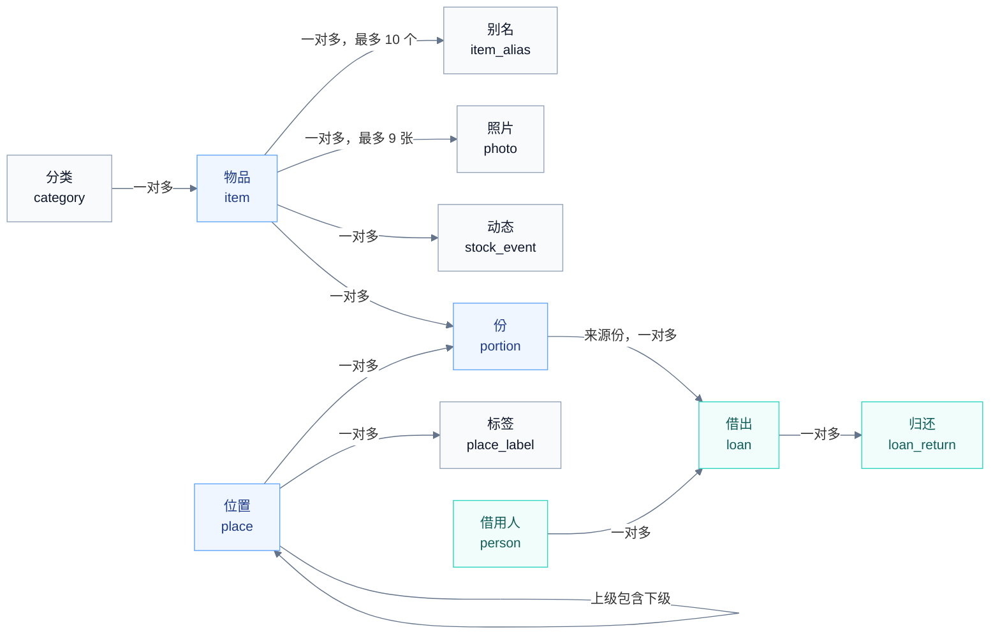

# 我的家当 · 数据与规则

本文定义应用的数据模型、业务规则、文件与外部格式，是实现存储层和业务层的依据。规则编号 R1 至 R40 在其他文档中引用。界面见 [experience.md](experience.md)，需求见 [request.md](request.md)，系统能力见 [harmonyos.md](harmonyos.md)。

## 存储约定

| 项目 | 约定 |
| --- | --- |
| 数据库 | ArkData 关系型数据库，文件名 `nest.db`，安全级别 S3。结构版本从 1 开始，以后每次改结构加 1，升级在一个事务内逐级执行 |
| 偏好 | Preferences 文件 `nest_settings`，保存设置、开关、一次性提示和草稿 |
| 照片 | 应用沙箱 `files/photos/`：原图 `{photoId}.jpg`，缩略图 `{photoId}_s.jpg`，抠图 `{photoId}_cut.png` |
| 备份 | `files/backups/auto/` 放自动备份（保留最近 3 份），`files/backups/safety/` 放恢复前的安全备份（保留 1 份） |
| 主键 | UUID 字符串 |
| 时间 | 时间点存毫秒时间戳；到期日、约定归还日、推迟日存本地日历日 `YYYY-MM-DD` |
| 数量 | 以百分之一为单位的整数保存，1.5 盒存为 150，比较和计算都用整数，避免小数误差 |

## 实体关系

蓝色是核心的物品、份、位置，青色是借还，灰色是附属信息。物品的"动态"由 `stock_event`、`loan`、`loan_return` 三张表按时间合并而成。待办、在手数量、最早到期日等都是计算结果，不单独保存。

## 表结构

所有表都有 `created_at` 和 `updated_at`（毫秒时间戳），下表不再重复列出。

### item 物品

| 字段 | 类型 | 说明 |
| --- | --- | --- |
| id | TEXT 主键 | |
| name | TEXT 非空 | 1 至 80 字，去掉首尾空白 |
| name_pinyin | TEXT | 名称的全拼和首字母，供搜索（R32） |
| category_id | TEXT | 分类，可空 |
| is_consumable | INTEGER | 1 是消耗品，0 是普通物品（R18） |
| unit | TEXT 非空 | 单位，取自单位表 |
| notes | TEXT | 备注，不超过 500 字 |
| barcode | TEXT | 条码或二维码内容，不超过 256 字符，建索引 |
| reminder_days | INTEGER | 提前提醒天数 0 至 365；空表示使用默认天数 |
| restock_mode | TEXT 非空 | `WHEN_EMPTY` 用完时提醒（默认）、`BELOW` 少于设定数量时提醒、`OFF` 不提醒 |
| restock_threshold | INTEGER | `BELOW` 时的设定数量（百分之一单位） |
| cover_photo_id | TEXT | 封面照片 |
| last_activity_at | INTEGER | 最近一次记下、数量变化、移动、借还的时间，用于"最近动过"排序 |
| last_viewed_at | INTEGER | 最近一次打开物品页的时间 |
| deleted_at | INTEGER | 删除时间；不为空表示在最近删除中（R26） |
| version | INTEGER 非空 | 每次修改加 1，供撤销核对（R15） |

### item_alias 别名

| 字段 | 类型 | 说明 |
| --- | --- | --- |
| item_id | TEXT | 联合主键 |
| alias | TEXT | 联合主键，1 至 20 字；同一物品内不重复 |
| alias_pinyin | TEXT | 全拼和首字母 |

每件物品最多 10 个别名。

### portion 份

| 字段 | 类型 | 说明 |
| --- | --- | --- |
| id | TEXT 主键 | |
| item_id | TEXT 非空 | |
| place_id | TEXT | 位置；为空表示"未放位置" |
| quantity | INTEGER 非空 | 这一份的数量（百分之一单位），包含从这份借出、还没还的 |
| expiry_date | TEXT | 到期日，可空 |
| snoozed_until | TEXT | 推迟提醒到这一天（R22） |
| expiry_ack | INTEGER | 1 表示"不再提醒这一份"；到期日改变时清零 |
| version | INTEGER 非空 | 每次修改加 1 |

`(item_id, place_id, expiry_date)` 建唯一索引，空值按相同处理，保证同一位置、同一到期日只有一份（R4）。

### place 位置

| 字段 | 类型 | 说明 |
| --- | --- | --- |
| id | TEXT 主键 | |
| parent_id | TEXT | 上级位置；为空是顶层 |
| name | TEXT 非空 | 1 至 40 字；同一上级下不重复，比较时忽略大小写和首尾空白 |
| path | TEXT 非空 | 从顶层到本级的名称，用" › "连接，例如"卧室 › 衣柜 › 上层"；改名和移动时与所有下级一起更新 |
| path_pinyin | TEXT | 路径中各级名称的全拼和首字母 |
| sort_order | INTEGER | 同级排序 |
| photo_id | TEXT | 位置照片，可空 |
| last_used_at | INTEGER | 最近一次在记下、补货、移动中被选中的时间（R31） |

层级最多 6 级，完整路径不超过 200 字（R28）。

### place_label 标签

| 字段 | 类型 | 说明 |
| --- | --- | --- |
| token | TEXT 主键 | 随机 UUID，写进二维码和 NFC 标签（R30） |
| place_id | TEXT 非空 | 指向的位置 |
| name | TEXT | 标签名称，不超过 40 字，例如"冬季衣物箱" |
| kind | TEXT | `QR` 或 `NFC`，只用于显示 |

### category 分类

| 字段 | 类型 | 说明 |
| --- | --- | --- |
| id | TEXT 主键 | |
| name | TEXT 非空 | 1 至 40 字，全局唯一 |
| is_preset | INTEGER | 是否预设分类 |
| consumable_default | INTEGER | 新建物品选了这个分类时，是否默认是消耗品（R19） |
| archived | INTEGER | 停用后不再出现在候选里，已经用了这个分类的物品保留 |
| sort_order | INTEGER | |

### photo 照片

| 字段 | 类型 | 说明 |
| --- | --- | --- |
| id | TEXT 主键 | |
| item_id | TEXT 非空 | |
| kind | TEXT | `PHOTO` 照片或 `DOCUMENT` 扫描的说明书、保修卡 |
| source | TEXT | `CAMERA`、`ALBUM`、`SHARE`、`SCAN` |
| file / thumb / cutout | TEXT | 原图、缩略图、抠图的相对路径；抠图可空 |
| width / height / bytes | INTEGER | 原图尺寸和大小 |
| sort_order | INTEGER | 0 是封面 |
| indexed | INTEGER | 是否已加入以文搜图索引 |

每件物品最多 9 张（R37）。

### person 借用人

| 字段 | 类型 | 说明 |
| --- | --- | --- |
| id | TEXT 主键 | |
| name | TEXT 非空 | 1 至 80 字，唯一，比较时忽略大小写和首尾空白 |
| contact_key | TEXT | 从系统联系人选择时记下的标识，可空 |
| last_lent_at | INTEGER | 最近一次借出时间，决定候选顺序（R13） |

### loan 借出

| 字段 | 类型 | 说明 |
| --- | --- | --- |
| id | TEXT 主键 | |
| item_id | TEXT 非空 | |
| portion_id | TEXT 非空 | 来源份（R10） |
| person_id | TEXT | 借用人；为空表示未填写 |
| quantity | INTEGER 非空 | 借出数量，大于 0 |
| lent_at | INTEGER 非空 | 借出时间 |
| due_date | TEXT | 约定归还日，可空 |
| note | TEXT | 不超过 200 字 |
| voided_at | INTEGER | 撤销时间（R12） |
| version | INTEGER 非空 | |

### loan_return 归还

| 字段 | 类型 | 说明 |
| --- | --- | --- |
| id | TEXT 主键 | |
| loan_id | TEXT 非空 | 对应的借出 |
| quantity | INTEGER 非空 | 归还数量，大于 0 |
| returned_at | INTEGER 非空 | |
| note | TEXT | |
| voided_at | INTEGER | 撤销时间 |

### stock_event 动态

| 字段 | 类型 | 说明 |
| --- | --- | --- |
| id | TEXT 主键 | |
| item_id | TEXT 非空 | |
| portion_id | TEXT | 涉及的份 |
| type | TEXT 非空 | `CREATE` 记下、`STOCK_ADD` 补货、`CONSUME` 用掉、`DISCARD` 过期处理、`MOVE` 移动、`ADJUST` 更正数量、`DELETE` 删除、`RESTORE` 恢复 |
| quantity | INTEGER | 涉及的数量 |
| from_place_id / to_place_id | TEXT | 移动的起点和终点 |
| note | TEXT | |
| receipt | TEXT | JSON 回执：受影响的份在操作前后的数量、位置、到期日和版本号（R16） |
| voided_at | INTEGER | 被撤销的时间 |

### reminder_plan 提醒计划

| 字段 | 类型 | 说明 |
| --- | --- | --- |
| date | TEXT 主键 | 提醒日 |
| fire_at | INTEGER | 提醒时刻 |
| system_reminder_id | INTEGER | 系统代理提醒的 ID |
| content_hash | TEXT | 通知内容的哈希，内容变了才重新发布 |
| status | TEXT | `SCHEDULED`、`FAILED`、`FIRED` |
| error | TEXT | 失败原因，只用于诊断 |

### search_history 最近搜索

`id`、`query`、`created_at`。保留最近 20 条，相同内容只留最新的一条。

### backup_snapshot 备份记录

`id`、`kind`（`AUTO` 或 `SAFETY`）、`file`、`bytes`、`item_count`、`photo_count`、`created_at`。

## 偏好

| 键 | 取值 | 默认 |
| --- | --- | --- |
| theme | `SYSTEM`、`LIGHT`、`DARK` | `SYSTEM` |
| reminder_enabled | 到期提醒是否开启 | false |
| reminder_asked | 是否已经询问过到期提醒（R25） | false |
| default_reminder_days | 0 至 365 | 7 |
| reminder_time | `HH:mm` | `09:00` |
| list_sort | `RECENT_ACTIVITY`、`RECENT_CREATED`、`NAME`、`EXPIRY` | `RECENT_ACTIVITY` |
| allow_assistant | 允许小艺查询与操作 | true |
| allow_system_search | 允许系统搜索物品 | true |
| search_show_location | 系统搜索结果显示位置 | true |
| allow_photo_search | 照片外观搜索 | true |
| allow_local_qa | 问问家当（端侧问答） | true |
| allow_intent_sharing | 向系统分享常用操作，用于小艺建议 | true |
| live_view_backup / live_view_session / live_view_shopping | 备份、连续记下、购物三种实况窗 | true |
| auto_backup | 自动备份 | true |
| onboarding_done | 首次使用引导是否完成 | false |
| hints_shown | 已经显示过的一次性提示 | 空列表 |
| capture_draft | 记下面板的草稿 JSON | 空 |

## 业务规则

### 数量与份

| 编号 | 规则 |
| --- | --- |
| R1 | **共有**：物品的共有数量等于它所有份的数量之和。 |
| R2 | **单位**：单位只记在物品上，所有份和借还都用这个单位。改单位不换算数值，界面提示一次。 |
| R3 | **数量格式**：数量是 0 到 1,000,000 之间、最多两位小数的数。用掉、补货、借出、归还、移动的数量大于 0。 |
| R4 | **份的唯一与合并**：同一物品在同一位置、同一到期日（或都没有到期日）只有一份。补货、移动、拆分后如果出现相同组合，就合并到已有的那一份，数量相加。 |
| R5 | **份的清理**：一份的数量变成 0、且没有借出未还时，删除这一份；撤销时按回执恢复。 |
| R6 | **每份在手**：每笔借出未还记在它的来源份上。一份的在手 = 份数量 − 记在这份上的借出未还，最小为 0。物品的在手 = 各份在手之和。 |
| R7 | **最早到期**：物品的到期日取数量大于 0 的份里最早的到期日。 |
| R8 | **上限**：用掉、借出、移动的数量不超过对应份的在手。更正数量后，份数量不能低于记在这份上的借出未还。 |
| R9 | **更正数量**：用户输入这一份所在位置现在实际有的数量，保存为"输入值 + 记在这份上的借出未还"。 |

### 借出与归还

| 编号 | 规则 |
| --- | --- |
| R10 | **来源份**：每笔借出必须来自一份。只有一份时自动选中，有多份时默认在手最多的一份，用户可以改。 |
| R11 | **归还**：归还关联到一笔借出，数量不超过这笔的未还。一笔的未还 = 借出数量 − 未撤销的归还数量之和。 |
| R12 | **撤销与纠正**：撤销借出或归还只写 `voided_at`，恢复时清空。撤销一笔借出时，它的归还一并撤销。纠正可以改借用人、数量、约定日期和备注，改完后未还不能小于 0，在手不能小于 0。 |
| R13 | **借用人**：输入的名字和已有借用人相同（忽略大小写和首尾空白）时归为同一人。候选按最近一次借出排序，最多 6 个，不含只出现在已撤销记录里的人。 |

### 写入与撤销

| 编号 | 规则 |
| --- | --- |
| R14 | **事务**：每个改动在一个数据库事务里读取最新数据、校验、写入数据和动态。同一个数据库的写操作排队执行，不并发。 |
| R15 | **版本号**：物品、份、借出每次修改，版本号加 1。 |
| R16 | **撤销**：可撤销的操作都返回回执，记下受影响的物品、份、借出或字段在操作前后的值和版本号。撤销时在一个事务里核对版本号：都没被后续操作改过才恢复，并把对应动态标为"已撤销"；否则拒绝并说明原因。 |
| R17 | **动态**：记下、补货、用掉、过期处理、移动、更正数量、删除、恢复写入 `stock_event`；借出和归还由 `loan`、`loan_return` 记录；资料编辑不进动态。每次写入同时更新物品的 `last_activity_at`。 |

### 消耗品与补货

| 编号 | 规则 |
| --- | --- |
| R18 | **消耗品**：只有消耗品显示在手数量、用完状态、用掉、补货和补货提醒，并参与购物清单。普通物品共有为 1 时不显示数量，大于 1 时显示"×N"。切换类型只改变显示和可用操作，数据都保留。 |
| R19 | **默认类型**：新建物品时，所选分类的 `consumable_default` 为真则默认是消耗品，否则是普通物品。预设分类中药品、食品、生活用品为真。 |
| R20 | **要补货**：消耗品在补货提醒为"用完时"且共有为 0，或为"少于设定数量"且共有小于设定数量时要补货；"不提醒"时不进入购物清单。用共有判断，因为借出的会还回来。 |
| R21 | **补货预填**：补货面板的数量和位置取这件物品最近一次补货；没有补货记录时数量为 1，位置取在手最多的一份所在位置，再没有就取最近一次所在的位置。 |

### 到期、待办与提醒

| 编号 | 规则 |
| --- | --- |
| R22 | **待办口径**：已过期是在手大于 0、到期日早于今天的份。快到期是在手大于 0、到期日在今天到今天加 N 天之间的份，N 是物品的提前提醒天数，没有设置时用默认天数。该还了是设了约定归还日、日期早于或等于今天、未还大于 0 的借出。要补货见 R20。借出未还是所有未还大于 0 的借出，按借用人分组。推迟到某天的份在那天之前不计入；"不再提醒"的份不计入，到期日改变后恢复。最近删除中的物品不计入任何一组。 |
| R23 | **角标**：角标数是已过期、快到期、该还了三组的条目数之和。首页提示条和桌面卡片使用同一口径。 |
| R24 | **提醒计划**：开启到期提醒后，每个需要提醒的日期安排一条系统代理提醒，时间为提醒时刻。份的提醒日 = 到期日 − N 天；已过提醒日但还没到期的，在下一个可用时刻提醒一次；已过期的不再提醒。借出的提醒日 = 约定归还日。同一天的条目合并为一条通知，内容哈希变了才更新。只安排最近的若干天，总数在系统上限以内。打开应用、数据变化、跨天、设置变化和提醒触发后重新对账，增删改到与计算结果一致；只取消本应用记录过的系统提醒。 |
| R25 | **首次询问**：`reminder_asked` 为假时，第一次保存带到期日的物品后询问是否开启到期提醒，回答后置为真。 |

### 删除

| 编号 | 规则 |
| --- | --- |
| R26 | **最近删除**：删除物品只写 `deleted_at`。在最近删除期间，物品不出现在列表、搜索、待办、卡片、小艺和系统搜索中；它的提醒取消，以文搜图索引移除，共享给系统的意图和实体删除。恢复时清空 `deleted_at`，重建索引，对账提醒。 |
| R27 | **永久删除**：`deleted_at` 超过 30 天，或用户在最近删除里选择永久删除时，在一个事务里删除物品及其份、借还、动态、别名、照片记录；事务提交后再删除照片文件。 |

### 位置与标签

| 编号 | 规则 |
| --- | --- |
| R28 | **层级**：位置最多 6 级，完整路径不超过 200 字，同一上级下名称不重复。位置不能移到自己的下级。改名和移动在一个事务里更新自身和所有下级的 `path`；份引用的是位置 ID，不受影响。 |
| R29 | **删除与合并**：删除位置前，把其中的份和下级位置移到用户选择的位置（默认上级），绑定的标签一并删除。合并位置时，份、下级位置和标签都转到目标位置；转移后按 R4 合并重复的份，目标下已有同名下级时，两个下级继续按本规则合并。两种操作都在一个事务里完成。 |
| R30 | **标签**：标签 token 是随机 UUID，扫描内容是 `itemnest://location/{token}`。标签只指向位置 ID，位置改名、移动不影响。改绑只更新 `place_id`；删除位置或解除关联后，扫描提示"这个标签没有关联位置"。 |
| R31 | **最近用过**：在记下、补货、移动、批量移动中选中位置时，更新它的 `last_used_at`。 |

### 搜索

| 编号 | 规则 |
| --- | --- |
| R32 | **匹配与排序**：关键词按空格拆开，每个词都要命中名称、别名、分类名、位置路径、条码或备注中的至少一项。名称、别名、位置路径同时按全拼和首字母匹配。每个词按命中的最好一档计分：名称完全相同 1、名称开头 2、名称包含 3、别名 4、名称拼音 5、位置或分类 6、条码 7、备注 8；各词得分之和越小越靠前，相同时按 `last_activity_at` 从新到旧。 |
| R33 | **最近搜索**：执行过的搜索写入 `search_history`，保留 20 条，可以一键清空。 |

### 外部请求、识别与 AI

| 编号 | 规则 |
| --- | --- |
| R34 | **外部改动需确认**：来自小艺、智能体、链接、NFC、通知、系统分享的新增和改动，先打开应用内预填的面板，用户确认后才保存。例外：用户在本应用桌面卡片上点"用掉 1"会直接记一笔，卡片上提供撤销。 |
| R35 | **识别只作候选**：文字识别、物体检测、语音解析的结果只作为候选，用户点选或确认后才写入。没有明确的到期标签时，不把生产日期当作到期日；由生产日期和保质期推算出的到期日标明"推算"。 |
| R36 | **问答依据**：问问家当先由应用查询数据库，得出相关物品、数量、位置和日期，再交给端侧问答模型组织成一句话；数字和位置以应用的计算为准，回答下方列出依据的物品卡片。模型不可用时只显示查询结果。 |

### 照片与隐私

| 编号 | 规则 |
| --- | --- |
| R37 | **照片处理**：导入时转成 JPEG，长边不超过 2048 像素，生成长边 512 像素的缩略图；主体分割成功时生成抠图 PNG。每件物品最多 9 张。开启照片外观搜索时，把照片加入以文搜图索引；删除或更换时同步移除。 |
| R38 | **孤儿清理**：每次启动后在后台删除没有记录引用的照片文件。 |
| R39 | **隐私开关**：各开关关闭后的行为见下表。 |
| R40 | **恢复备份**：依次为文件校验、预览、确认、保存安全备份、解出照片到暂存目录、事务替换数据、重建索引和提醒、清理暂存与旧照片。提交事务前可以取消；取消或失败时删除暂存文件，当前数据不变。 |

| 开关 | 关闭后 |
| --- | --- |
| 允许小艺查询与操作 | 意图和智能体返回"未开启"，不读取数据 |
| 允许系统搜索物品 | 实体查询返回空，已共享的实体删除 |
| 系统搜索结果显示位置 | 实体不带位置 |
| 照片外观搜索 | 不建索引，已建的清除；搜索不提供"按外观找" |
| 问问家当 | 搜索中不出现问答，不调用端侧问答模型 |
| 向系统分享常用操作 | 不再分享，已分享的意图全部删除 |
| 三种实况窗 | 对应场景不创建实况窗，应用内照常显示进度 |
| 自动备份 | 不再生成，已有的保留 |

## 枚举

| 名称 | 取值 |
| --- | --- |
| 单位 | 个、盒、瓶、包、件、支、片、卷、双、袋、本、克、毫升、其他 |
| 预设分类 | 药品（消耗品）、食品（消耗品）、证件、工具、办公、生活用品（消耗品）、儿童用品、宠物用品、其他 |
| 常见房间 | 客厅、卧室、厨房、卫生间、书房、阳台、玄关、储物间 |
| 补货提醒方式 | 用完时、少于设定数量时、不提醒 |
| 功能入口 | `add` 记下、`scan` 扫码记下、`camera` 拍照记下、`voice` 语音记下、`search` 查找、`todo` 待办、`expiry` 待办的到期分组、`loans` 借出未还、`shopping` 购物清单、`backup` 备份与恢复、`system` 系统能力与隐私 |

## 数量和长度限制

| 项目 | 限制 |
| --- | --- |
| 物品名称 | 1 至 80 字 |
| 别名 | 每个 1 至 20 字，每件最多 10 个 |
| 备注 | 物品 500 字；借出 200 字 |
| 条码 | 256 字符 |
| 分类名称 | 1 至 40 字 |
| 位置名称 | 每级 1 至 40 字，最多 6 级，完整路径 200 字 |
| 标签名称 | 40 字 |
| 借用人姓名 | 1 至 80 字 |
| 数量 | 0 至 1,000,000，最多两位小数 |
| 提前提醒天数 | 0 至 365 |
| 照片 | 每件 9 张；单张原图导入后不超过 10 MiB |
| 最近搜索 | 20 条 |
| 自动备份 | 保留 3 份 |
| 最近删除 | 保留 30 天 |

## 外部格式

### 链接

| 链接 | 打开 |
| --- | --- |
| `itemnest://item/{itemId}` | 物品页；物品在最近删除中或不存在时提示并停在物品栏目 |
| `itemnest://location/{token}` | 标签对应的位置页；没有关联时提示"这个标签没有关联位置" |
| `itemnest://function/{action}` | 功能入口，`action` 取值见枚举表 |

链接总长不超过 4096 字符，ID 和 token 不超过 200 字符、不含控制字符，否则忽略。

### 标签

二维码内容和 NFC 标签的 NDEF URI 记录都是 `itemnest://location/{token}`。token 是随机生成的 UUID。标签图片包含二维码、位置名、完整路径和"我的家当 · 扫一扫查看物品"。

### 分享文本

| 内容 | 格式 |
| --- | --- |
| 物品 | 名称、位置；可选附带数量、到期日、备注和封面照片 |
| 位置清单 | 位置路径，下面逐行"名称 · 数量（消耗品）"，可选附带下级位置名 |
| 借出清单 | 按借用人分组，逐行"物品 · 数量 · 借出日期 · 约定日期" |
| 购物清单 | 标题"购物清单（N）"，逐行"□ 名称（用完了 / 剩 X 单位）" |
| 提醒对方 | "之前借你的{物品}，用完记得还我哦。"，用户可以修改 |

### 备份包

便携备份是一个 zip 文件，扩展名 `.itemnest`，默认文件名"我的家当备份-YYYYMMDD-HHmm.itemnest"。

| 包内文件 | 内容 |
| --- | --- |
| `manifest.json` | `format: "itemnest-backup"`、`version: 1`、创建时间、应用版本、各表记录数、`data.json` 和每个照片文件的 SHA-256 |
| `data.json` | 除 `reminder_plan`、`backup_snapshot` 之外的全部表，包含最近删除中的物品；偏好中的 `theme`、`default_reminder_days`、`reminder_time`、`list_sort` |
| `photos/` | 原图和抠图；缩略图在恢复时重新生成 |

恢复时先校验 `format` 和 `version`、记录结构、规则（R1 至 R13、R28）和每个文件的哈希，任何一项不通过都不改动当前数据。单张照片不超过 10 MiB；开始恢复前检查剩余空间不少于备份包大小的两倍。恢复顺序见 R40。
