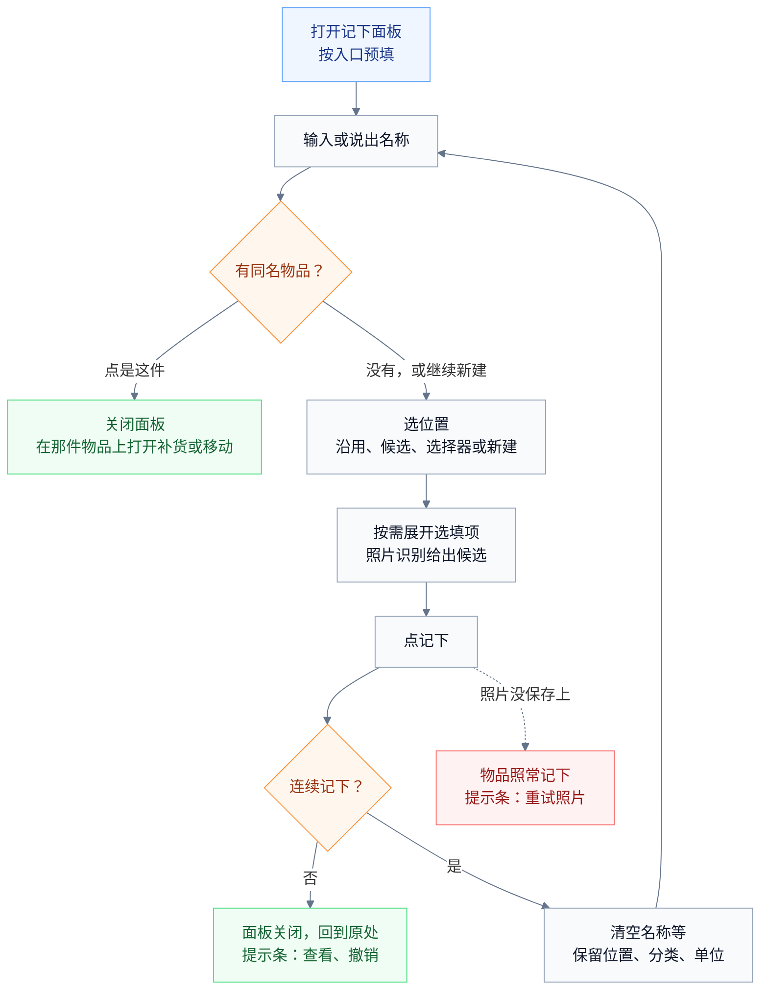

# 我的家当 · 交互与界面

本文说明每个页面、面板、卡片和系统入口的结构与操作：放什么、按什么顺序排、点了之后发生什么。读者是实现界面的工程师和评审交互的人。文中的结构示意只表达内容和顺序；颜色、材质（G1 至 G5）、光效（P1 至 P6）、动效（M01 至 M33）、触感（H1 至 H7）的定义见 [design.md](design.md)，需求编号见 [request.md](request.md)，业务规则（R1 至 R40）见 [data.md](data.md)。

## 全局约定

### 底栏

底栏是悬浮在内容之上的玻璃胶囊（G1），五个位置依次为：物品、位置、＋、待办、我的。

- ＋不是栏目：点击后在当前页面打开记下面板（M04），所在栏目不变；长按沿弧线弹出四个快捷项：语音、扫码、拍照、连续。
- 待办显示角标，计数口径见 R23。
- 切换栏目时，高亮胶囊跟随手指滑动（M02），触感 H1。
- 列表快速向下滚动时，底栏收窄为只有图标的胶囊；向上滚动或停止 1 秒后恢复（M03）。
- 键盘弹出时底栏隐藏。底栏开启左右手适配，单手握持时向操作手一侧偏移。

### 标题栏

各栏目首页有大标题，滚动时收起为小标题，标题栏由透明渐变为材质（G2，M05）。"物品"栏目的大标题"我的家当"用品牌渐变文字，旁边是用户所选形象的小头像。

### 面板

记下、用掉、补货、移动、借出、归还、更正数量、补货提醒、过期处理、选位置、选分类都是底部面板（G3）；窗口宽度不小于 700vp 时居中显示。

- 打开时预填默认值，主按钮固定在底部，键盘弹出时随之上移。
- 面板内要选位置或分类时，在同一面板内切换到选择视图（M15），选完回到原视图；面板不叠加第二层。
- 返回键和下滑都只关闭面板。记下面板关闭时保存草稿；其他面板输入很少，关闭即放弃。

### 提示条与撤销

操作完成后，底栏上方弹出提示条（`HdsSnackBar`，M16）：一句结果，加"撤销"，需要时再加"查看"。

```text
已用掉 1 盒，还剩 5 盒                         撤销
已移到 书房 › 抽屉                              撤销
已借给小王                                      撤销
已记下"充电器" · 书房 › 抽屉              查看  撤销
```

- 显示 5 秒，"撤销"旁的细环表示剩余时间；读屏开启时显示 10 秒并可被读屏聚焦。
- 新提示条替换旧的；提示条消失后，借还可以在动态里纠正，数量可以用"更正数量"改回。
- 撤销时如果相关的份已被其他操作改过，提示"这之后又有改动，没法撤销"。

### 加载、空状态和出错

- 加载：列表先显示占位行；超过 300 毫秒仍未完成才显示加载文字。
- 空状态：形象插画（抱着空箱子），一句说明，一个操作，例如"这里还没有东西｜在这里记下"。
- 出错：一句原因加"重试"；刷新失败时保留已经显示的数据。

### 手势

- 侧滑返回：页面跟手退出；从物品页返回时，封面和名称沿共享元素飞回列表（M11）。
- 长按物品卡片：卡片抬起，弹出玻璃菜单（M10），触感 H6。
- 列表行左滑：露出该行的其余操作（待办、物品列表）。
- 拖动：位置页和宽屏下可以拖动物品卡片（M28）。

### 权限请求时机

应用启动和首次引导时不请求任何权限。第一次用语音时请求麦克风，第一次连续扫码时请求相机，第一次回答"提醒我"时请求通知。被拒绝后，对应入口说明原因并提供"去设置"。

### 宽屏

平板和展开的折叠屏上：物品栏目左边列表、右边物品页；位置栏目左边位置树（`HdsSideBar`）、右边位置页。可以把物品拖到左侧位置树的某个位置上完成移动。连接键盘时支持 Ctrl+F、Ctrl+N、Esc、Ctrl+Z（NAV-08）。

### 一次性提示

长按菜单、连续记下、下拉唤起这类不显眼的操作，第一次用得上时提示一次，例如列表里有 3 件以上物品时提示"长按物品，可以直接用掉、移动或借出"，点"知道了"后不再出现。

## 启动与首次使用

**启动**：启动窗显示品牌底色和所选形象；首页出现时，形象缩小飞到大标题旁，内容错峰出现（M01）。首帧先显示搜索框。

**首次使用**（三屏，每屏都能跳过）：

1. 欢迎：形象挥手，一句"记住家里每样东西在哪"，按钮"开始""从备份恢复"。
2. 选房间：常见房间多选（客厅、卧室、厨房、卫生间、书房、阳台、玄关、储物间），创建为顶层位置。
3. 记下第一件：列出常找物品建议（证件、充电器、药箱、备用钥匙、说明书和保修卡、工具箱），点一项打开记下面板并预填名称。

## 物品（首页）

```text
我的家当  [形象]                                           （大标题）
├─ 搜索框：找什么？名称、位置或拼音          [麦克风] [扫码]   （G2）
├─ 待办提示条：2 件已过期 · 1 件快到期 · 3 件要补货       ›    （有待办时）
├─ 筛选：全部｜消耗品｜借出中｜有到期日｜分类 ▾              排序 ▾
└─ 列表
    ├─ [抠图] 护照
    │         卧室 › 衣柜 › 上层
    ├─ [抠图] 抽纸                                        剩 2 包
    │         储物间 › 上层
    ├─ [抠图] 电钻                                  借给小王 · 12 天
    │         储物间 › 工具箱
    └─ [抠图] 感冒灵颗粒                                  3 天后过期
              客厅 › 电视柜 › 药箱
```

**列表行**：左边是封面（有抠图时用抠图，悬浮在浅色底上带柔和阴影），第一行名称，第二行位置；分处存放时第二行显示"放在 2 处"。右侧只放一个最需要注意的信息，优先级依次为：已过期、快到期、借出中、消耗品的在手数量（用完时显示"用完了"）、普通物品多于 1 件时的"×N"。按下时卡片微缩并有点光源（M09）。

**浏览**：默认按"最近动过"排序。排序还有最近记下、名称、到期日，选择后自动记住。

**搜索**（M06、M07）：

- 点搜索框直接弹出键盘，不切换栏目；输入时列表实时换成结果，命中部分高亮；分处存放的物品显示命中的那一处位置。
- 搜索框为空时显示最近搜索，可以清空。
- 只有一个结果且名称完全相同时，顶部显示答案卡：大号抠图、大字号位置和两个操作（普通物品"移动""借出"，消耗品"用掉 1""补货"）。
- 点麦克风开始语音（M23）：说"护照在哪"直接搜；说"充电器放书房抽屉"转到记下面板；说"用掉一包纸巾"打开对应物品的用掉面板。

**问问家当**（M24）：输入或说出的是问题时（含"吗、几、哪、多少、什么"，或点结果上方的"问问家当"），结果顶部出现回答卡：

```text
问问家当                                           [朗读]
家里还有 2 节 5 号电池，在 书房 › 抽屉。上次补货是 10月3日。
├─ 依据：[抠图] 5 号电池 · 2 节 · 书房 › 抽屉
└─ 在小艺里继续问 ›                                 （设备支持时）
```

回答生成时卡片边缘有流光，文字逐句出现；数字和位置来自应用查询（R36）。端侧问答不可用或关闭时，不显示回答句，只显示依据卡片。

**无结果**：显示"没找到'护照'"和"记下'护照'"按钮（打开记下面板并预填名称）；有带照片的物品且外观搜索可用时，再提供"按外观找"，结果标注"外观相似"、与名称结果分开。

**还没有物品**：显示首次使用的第 3 屏内容；搜索框照常可用。

**操作**：

- 点一行：打开物品页（M11），宽屏时在右栏打开。
- 长按一行：消耗品菜单"用掉 1、用掉…、补货、移动、多选"；普通物品菜单"移动、借出、多选"，有借出未还时加"归还"，全部借出时去掉"借出"。菜单里的操作都在当前页面完成。
- 多选：底部出现"移动到、设分类、分享、删除"，批量完成后可以整体撤销。
- 下拉（P2）：顶部下拉进入搜索，继续下拉出现麦克风，松手开始语音（M33）。

## 记下面板

```text
记下                                     [麦克风]       连续记下 ○
├─ 名称：是什么？                                         （打开即聚焦）
│   └─ 已有：充电器 · 书房 › 抽屉                   [是这件]  （有重名时）
├─ 位置：书房 › 抽屉  ×
│   └─ 最近：书房 › 抽屉｜卧室 › 床头柜｜厨房 › 吊柜｜玄关｜选择…
├─ 选填：照片｜数量｜到期｜分类｜备注｜条码｜别名            （点哪项展开哪项）
└─                                                             [记下]
```



**名称**：唯一必填项，没填时"记下"不可点。输入时检查重名：去掉空格后相同，或一方包含另一方，就在名称下方列出已有物品和位置（最多 3 件）；点"是这件"关闭面板，在那件物品上打开补货面板（消耗品）或移动面板（普通物品）。

**位置**：

- 连续记下时沿用上一件的位置；其他情况不自动选中，最近用过的位置排在候选第一个。
- 候选是最近用过的 5 个位置和"选择…"，后者在面板内打开位置选择器。
- 在位置框里打字，会同时按名称和拼音搜索已有位置；没有匹配时可以"新建'阳台柜'"，接着选它放在哪个位置下面，默认顶层。
- 留空保存为"未放位置"。

**照片**（最多 9 张，第一张是封面）：

- 拍照、从相册选、扫描说明书（文档扫描，矫正成扫描件）三种来源。
- 加入照片后，在后台依次做：主体分割生成抠图（M20）、文字识别（M21）、读取条码。
- 识别结果以候选标签出现在对应输入项下方，例如"名称：鲜牛奶［用这个］""到期：2027-03-01［用这个］""条码：6901234567890［用这个］"；能从生产日期和保质期算出到期日时，给出"按生产日期 2026-03-01、保质期 12 个月推算：2027-03-01［用这个］"。点"用这个"才填入，不覆盖用户已经输入的内容。
- 点照片放大核对原图；长按缩略图可以拖动排序或删除。

**其他选填项**：

- 数量：步进器，默认 1，每步触感 H3；单位列表把最近用过的 3 个放在前面。物品是消耗品时，数量项默认展开。
- 到期：日期选择器和快捷项"3 天后、1 周后、1 个月后、3 个月后、1 年后"；下面一行"到期前 7 天提醒｜改"。
- 分类：按名称推荐的分类显示为已选中的"推荐"，可以取消或更换；"消耗品"开关在分类旁边，跟随分类给出默认值，也可以单独切换。
- 备注、条码（可以扫码）、别名（供搜索用，例如给"护照"加"出国证件"）。

**记下**：

- 普通模式：面板缩小飞向新物品在列表中的位置（M18），回到原处，提示条显示"已记下'充电器'"和"查看""撤销"，触感 H2。
- 连续模式：面板保留，清空名称、照片、数量、到期日、备注、条码和别名，保留位置、分类、单位和消耗品开关，焦点回到名称；标题显示"本次已记 3 件"（M19），点开可以查看，也可以删掉其中某一件。连续模式中离开应用时，显示连续记下实况窗 LV2。
- 在名称框按回车，等同点"记下"。
- 第一次保存带到期日的物品后，提示条询问"到期前提醒你？［提醒我］［不用］"。

**照片没保存上**：物品照常记下，提示条显示"照片没保存上｜重试"。

**草稿**：面板被下滑关闭、被外部入口打断或应用退到后台时保存当前输入；下次打开时顶部显示"继续记'护照'？［继续］［放弃］"。

### 语音记下

点面板右上角的麦克风，或长按＋选"语音"：全屏流光（M23），麦克风脉冲，识别的文字逐字出现；说完自动停止，也可以点"完成"。

```text
你说："两盒牛奶放冰箱冷藏层，下周五到期"
→ 名称：牛奶   数量：2 盒   位置：厨房 › 冰箱 › 冷藏层   到期：11月14日
```

解析结果预填到记下面板，用户核对后点"记下"（T12）。位置匹配不到时显示为"新建'冷藏层'"候选。

### 一拍多件

长按＋选"拍照"，取景界面底部可以切到"一拍多件"。拍一张抽屉或箱子的照片后：

```text
[照片：打开的抽屉]
├─ 检测框依次出现（M22）：□ 剪刀  □ 胶带  □ 充电线  □ 备用钥匙 ……
├─ 点框选中或取消，选中的裁剪图飞入下方托盘
└─ [记下 4 件]  位置：书房 › 书桌 › 左抽屉（统一预填）
```

点"记下 4 件"后进入连续记下，每件已带照片和位置，只需输入名称（框里有文字时预填识别出的名称候选）（T15）。设备不支持物体检测时不显示"一拍多件"。

### 连续扫码

长按＋选"扫码"：设备支持自定义扫码界面时，取景框带玻璃描边和扫光（M29），每扫到一个码，下方托盘加一条，触感 H2；扫完点"下一步"，进入连续记下逐件补名称和位置。条码已属于某件物品时，托盘里显示"已有：牛奶｜补货"。设备不支持时改用系统扫码界面，一次扫一个。

### 入口与预填

| 入口 | 预填 |
| --- | --- |
| 底栏＋ | 无；连续记下时沿用位置 |
| 长按＋ › 语音 | 语音解析出的名称、数量、位置、到期日 |
| 长按＋ › 扫码 | 条码；已存在时提示补货 |
| 长按＋ › 拍照 | 照片和识别候选；可切到一拍多件 |
| 长按＋ › 连续 | 打开连续记下 |
| 位置页"在这里记下""连续记下" | 位置；后者同时打开连续记下 |
| 搜索无结果"记下'xx'" | 名称 |
| 系统分享照片或文字 | 照片，或从文字解析出的名称、位置候选 |
| 小艺、智能体"记一下……" | 名称、数量、单位、位置、到期日 |
| 桌面卡片 W1 的＋ | 无 |
| 复制为新物品 | 分类、单位、位置、消耗品开关 |

## 位置选择器

```text
选位置
├─ 搜索：搜索位置（名称、路径、拼音）
├─ 最近：书房 › 抽屉｜卧室 › 床头柜｜厨房 › 吊柜
├─ 家 › 卧室                                          （点上级返回）
│   ├─ 衣柜                                         ›  （有下级）
│   ├─ 床头柜
│   └─ ＋ 在"卧室"里新建
└─                                                [选"卧室"]
```

- 点有下级的位置进入下一级；底部按钮始终是"选当前这一级"。
- 搜索结果显示完整路径；没有匹配时提供"新建'xx'"。
- 选中一个三级位置最多 4 次点击；在"最近"里时 1 次。
- 记下、补货、移动、批量移动都用这个选择器。

## 物品页

物品页的标题就是物品名称，封面和名称从列表以共享元素飞入（M11）。

```text
牛奶（消耗品）
├─ 头部：[大抠图] 牛奶 · 食品                         （封面可左右滑看其他照片）
│         明天到期
├─ 在手 6 盒，放在 2 处                              （大数字，M12）
│   ├─ 冰箱 › 冷藏层 · 2 盒 · 明天到期
│   ├─ 储物柜 · 4 盒 · 12月1日到期
│   └─ 少于 2 盒时提醒补货｜改
├─ 到期：最早明天到期 · 今天 9:00 已提醒
├─ 资料：分类｜备注｜条码｜别名｜单位｜提前提醒天数｜消耗品 开
├─ 动态：11月2日 用掉 1 盒 · 10月28日 补货 6 盒                    全部 ›
└─ 操作栏：[用掉 1]  [补货]  [移动]  [更多]                    （HdsActionBar）
```

```text
电钻（普通物品）
├─ 头部：[大抠图] 电钻 · 工具
│         借出中
├─ 储物间 › 工具箱                                          （大字号）
├─ 借出：小王 · 12 天前 · 约定 11月5日还，已过 2 天             [已归还]
├─ 资料：分类｜备注｜条码｜别名｜消耗品 关
├─ 动态：10月20日 借给小王 · 9月1日 移到 储物间 › 工具箱         全部 ›
└─ 操作栏：[移动]  [归还]  [更多]
```

- **头部**：大号抠图悬浮在品牌浅色底上，随滚动轻微视差。点封面打开大图（G4）：左右滑切换照片，菜单有"设为封面、更换、删除"；设备支持图像分析时，长按可以选取图中文字或抠出主体。点名称直接编辑。状态标签只显示需要注意的状态：已过期、快到期、借出中、要补货。
- **在手与份**：只有一份时合成一行，例如"在手 6 盒 · 储物柜"。多份时逐行列出每份的位置、在手数量和到期日；点一行打开这一份的操作：移动这一份、用掉、更正数量、改到期日。数量到 0 时显示"用完了"（M13）。
- **借出**：每笔一行，显示借用人、借出多久和约定日期；"已归还"一次归还这一笔的全部未还数量。
- **到期**：显示最早到期日、剩余天数和提醒状态。提醒状态只有三类：已安排（"11月13日 9:00 提醒"，到点后显示"已提醒"）；未开启（"提醒已关闭｜开启"）；发不出（一句原因和一个按钮，例如"通知被系统关闭｜去开启"）。
- **资料**：点一项，在面板里编辑并单独保存，可以撤销。改单位时提示"已有数量不会换算"。
- **动态**：最近 5 条，"全部"进入全部动态页。借出、归还可以在动态里纠正或撤销。
- **操作栏**：消耗品是"用掉 1、补货、移动、更多"。普通物品是"移动、借出、更多"；有借出未还时增加"归还"，全部借出时不显示"借出"。
- **更多**：借出（消耗品）、更正数量、补货提醒（消耗品）、分享、复制为新物品、删除。
- **删除**：物品进入最近删除，返回上一页，提示条"已删除'电钻'｜撤销"；有借出未还时先确认一次。

## 操作面板

| 面板 | 打开时的默认值 | 快捷项 | 完成后的提示条 |
| --- | --- | --- | --- |
| 用掉 | 数量 1；来源"自动"，从最早到期的一份扣 | 1、2、5、全部 | 已用掉 1 盒，还剩 5 盒；进入购物清单时加"，已加入购物清单" |
| 补货 | 上次补货的数量和位置；到期日空 | "和上次一样"一键确认 | 已补货 6 盒，在手 8 盒 |
| 移动 | 移动整份 | 最近用过的位置 | 已移到 书房 › 抽屉 |
| 借出 | 数量 1；从在手最多的一份拿 | 最近的借用人；约定归还：不确定、1 周后、1 个月后、选日期 | 已借给小王 |
| 归还 | 这一笔的全部未还数量 | — | 小王已归还电钻 |
| 更正数量 | 这一份当前在手的数量 | — | 已改为 3 盒 |
| 补货提醒 | 当前方式 | 用完时、少于几个时、不提醒 | 少于 2 盒时提醒补货 |
| 过期处理 | 这一份的全部在手 | — | 已处理 3 袋感冒灵颗粒 |

- 有多份时，"用掉""移动""借出"的面板里有"从哪一份"，默认值如上表；"更正数量"从份的那一行打开，不需要再选。
- "移动"可以只移一部分，数量默认整份。
- "更正数量"问的是"这里实际有几个"，输入这个位置现有的数量，不含借出。
- 数量超过在手时，主按钮不可点，下方一句话说明原因，例如"在手只有 2 盒，另有 1 盒借给了小王"，触感 H4。

## 待办

```text
待办                                                 [去购物] [分享购物清单]
├─ 已过期 2                                                    （悬浮分组标题）
│   ├─ 感冒灵颗粒 · 客厅 › 药箱 · 3 袋 · 过期 5 天              [处理掉]
│   └─ 护照 · 卧室 › 衣柜 · 过期 2 天                            [改日期]
├─ 快到期 1
│   └─ 牛奶 · 冰箱 › 冷藏层 · 2 盒 · 明天到期                      [用掉]
├─ 该还了 1
│   └─ 小王 · 电钻 · 约定 11月5日还                              [已归还]
├─ 要补货 3                                                   （购物清单）
│   ├─ 抽纸 · 用完了                                            [已买到]
│   └─ 洗衣液 · 剩 1 瓶                                          [已买到]
└─ 借出未还
    ├─ 小王 · 2 件 · 最早 12 天前                                     ›
    └─ 小李 · 1 件 · 3 天前                                           ›
```

每条右侧是最常用的操作，左滑或长按出现其余操作：

| 分组 | 主要操作 | 其余操作 |
| --- | --- | --- |
| 已过期（消耗品） | 处理掉：这一份在手清零，动态记"过期处理" | 改日期、不再提醒这一份 |
| 已过期（普通物品） | 改日期 | 不再提醒 |
| 快到期 | 用掉：打开用掉面板，来源是这一份 | 稍后（到期当天再提醒）、改日期 |
| 该还了 | 已归还 | 提醒对方、改约定日期 |
| 要补货 | 已买到：打开补货面板，可以"和上次一样" | 不再提醒补货 |
| 借出未还 | 点借用人展开每一笔，每笔可以"已归还" | 提醒对方 |

- 完成一条后主要操作变成对勾，整行收起，分组数字滚动；一组清空时放出暖金色粒子（M25），触感 H7；全部完成时形象庆祝（M26），显示"都处理好了"和一句提示，例如"给常用药填上到期日，到期前会提醒你"。
- **提醒对方**：打开分享预览，预填"之前借你的电钻，用完记得还我哦。"，可以修改后发送。
- **分享购物清单**：先预览再分享，格式见 data.md"分享文本"；分享预览打开时也可以碰一碰分享。
- **角标和首页提示条**：角标数是已过期、快到期、该还了三组的条目数之和；首页提示条按紧急程度最多显示三组数量。

### 购物模式

点"去购物"进入购物模式：

```text
购物中 · 已买 3/7                                        [结束购物]
├─ ☑ 抽纸
├─ ☑ 洗衣液
├─ ☐ 5 号电池
└─ ……
```

- 逐项勾选"已买到"，勾选时有对勾动效和触感 H1；同时显示购物实况窗 LV3，锁屏和通知中心可以看到未买的前 5 项和进度（T14）。
- 全部勾选或点"结束购物"后进入批量补货确认：每项默认"和上次一样"，可以逐项改数量、位置、到期日；确认后补货完成，实况窗关闭。
- 没有勾选就结束时，直接关闭实况窗，清单不变。

## 位置

```text
位置                                             [扫标签]  [＋ 新位置]
├─ 搜索：搜索位置
├─ 客厅 · 23 件 · 4 个下级                                           ›
├─ 卧室 · 41 件 · 6 个下级                                           ›
├─ 厨房 · 35 件                                                      ›
└─ 未放位置 · 4 件                                                   ›
```

```text
卧室 › 衣柜                                                          ⋯
├─ 下级：上层 12｜下层 8｜左侧抽屉 5｜＋
├─ 物品 25                                               只看这一层 ○
│   ├─ [抠图] 护照                                              上层
│   └─ ……
└─ 操作栏：[在这里记下]  [连续记下]

⋯ 菜单：标签、分享清单、改名、移到…、合并到…、删除
```

- 点位置卡片，卡片展开成位置页（M27）；路径导航可以点任一级返回。
- 位置页默认列出这一层和所有下级位置里的物品，行内注明所在的下级位置；打开"只看这一层"后只列这一层。长按位置卡片可以拖动调整同级顺序。
- **删除**：先选择其中的物品和下级位置移到哪里（默认上级），说明"12 件物品和 2 个下级位置将移到'卧室'，1 个标签将失效"，确认后执行。
- **合并到**：选择目标位置，说明影响后执行；用来整理"卧室衣柜"和"卧室 › 衣柜"这类重复位置。
- **还没有位置**：列出常见房间，多选后一键创建。

### 标签面板

```text
标签 · 卧室 › 衣柜
├─ 已绑定：冬季衣物箱（二维码）｜床头 NFC 贴纸           （点一项可以改名、解除）
├─ [生成二维码]   预览图含二维码、位置名、路径和"我的家当 · 扫一扫查看物品"
│                 → 保存到图库｜分享
├─ [写入 NFC]     "把手机背面贴近标签"（M30）；写前提示会覆盖标签原有内容
└─ [绑定已有标签]  扫码或碰 NFC；标签原来属于别的位置时先确认
```

- 用系统扫一扫、应用内扫码或碰 NFC 标签，都直接打开对应位置页（T8）。
- 扫到没有关联位置的标签时，提示"这个标签没有关联位置"，并提供"绑定到…"。

## 我的

```text
我的
├─ 提醒：到期提醒 开｜提前 7 天｜每天 9:00｜通知权限
├─ 数据：备份与恢复｜自动备份（上次 2 天前，占用 86 MB）｜最近删除 3
├─ 整理：分类管理
├─ 系统入口：系统能力与隐私｜桌面卡片｜实况窗
├─ 外观：主题｜应用图标
└─ 关于：使用技巧｜数据与隐私｜版本
```

- **提醒**：开关、默认提前天数、提醒时刻、通知权限状态和"去开启"；提醒发不出时显示一句原因，例如"系统暂时不允许本应用定时提醒，到期事项会显示在待办里"。
- **备份与恢复**：
  - "导出备份"：选择保存位置，显示进度（超过 3 秒同时显示实况窗 LV1），完成后提示文件名和大小。
  - "从文件恢复"：选择 `.itemnest` 文件 → 预览（物品、位置、照片数量和备份时间）→ "覆盖当前数据并恢复"（红色主按钮，唯一需要确认的操作之一）→ 进度 → 完成。恢复前的安全备份可以另存。
  - 失败时说明原因（文件损坏、格式不对、空间不足），当前数据不变。
- **自动备份**：开关、上次时间、占用空间；列出最近 3 份，可以导出或从中恢复。
- **最近删除**：见"其他页面"。
- **分类管理**：见"其他页面"。
- **系统能力与隐私**：开关列表（小艺查询与操作、系统搜索物品、系统搜索显示位置、照片外观搜索、问问家当、向系统分享常用操作、备份实况窗、连续记下实况窗、购物实况窗、自动备份），每项一句说明；下方"本机能力"列出文字识别、抠图、一拍多件、以文搜图、语音、问问家当、朗读在本机是否可用。
- **桌面卡片**、**实况窗**：在面板中介绍每种卡片和实况窗的样子和添加方法，提供"添加到桌面"。
- **外观**：主题三选一，立即生效；应用图标在两位形象间选择，选中后形象卡片放大带光（M31），图标切换成功后提示。
- **关于**：在面板中显示使用技巧（配动图）、数据与隐私说明、版本号。

除"系统能力与隐私""分类管理""最近删除"三个推入式页面外，"我的"里的设置直接在页面内修改，或在面板中完成。

## 其他页面

**全部动态**：按时间倒序列出一件物品的全部动态（记下、补货、用掉、过期处理、移动、更正、借出、归还、删除、恢复），按月分组；借出和归还可以纠正、撤销，被撤销的标注"已撤销"。

**最近删除**：列出删除的物品和剩余天数，每项可以"恢复"或"永久删除"；顶部"全部清空"需要确认。恢复后提示"已恢复'电钻'｜查看"。

**分享预览**：上方是生成的分享图片（带抠图封面和品牌底）或文字预览，下方是可选项开关（位置、备注、借用人、照片），底部"分享"调起系统分享面板；预览打开时可以碰一碰分享。

**分类管理**：分类列表（预设分类有标识），每项可以改名、停用或启用、设置"新物品默认是消耗品"，拖动排序；右上角"新分类"。改名时提示"已有 N 件物品会一起改名"。

## 桌面卡片

| 卡片 | 布局 |
| --- | --- |
| W1 找东西 2×2 | 上方搜索条（点击打开应用并弹出键盘），下方三个按钮：麦克风、＋、扫码 |
| W1 找东西 2×4 | 左侧同 2×2，右侧 3 件最近动过的物品（抠图、名称、位置） |
| W2 待办 2×2 | 大号角标数和"件待处理"，下面最紧急的 2 条 |
| W2 待办 2×4 | 最紧急的 4 条，每条右侧一个按钮（打开预填面板） |
| W2 待办 4×4 | 按分组列出，购物清单单独一块，右上角"去购物" |
| W3 借出未还 2×2、2×4 | 按借用人列出件数和最早借出天数 |
| W4 一个位置 2×2、2×4 | 位置名和路径，下面列出里面的物品和数量；在卡片编辑页选择位置 |
| W5 一件物品 1×1 | 只有抠图，点开物品页 |
| W5 一件物品 2×2 | 抠图、名称、位置 |
| W6 消耗品余量 2×2、2×4 | 2 至 4 件消耗品的抠图、在手数量和"用掉 1"；点按钮直接记一笔，数字从卡片里弹出（M32），卡片显示"已用掉｜撤销" 5 秒 |

- 卡片底色用品牌深绿，文字用浅色；单色主题模式下改用系统主题色。
- 出错时显示"暂时无法更新，点开重试"。

## 实况窗

| 实况窗 | 胶囊 | 展开区与锁屏 |
| --- | --- | --- |
| LV1 备份与恢复 | 进度"备份 45%" | 标题"正在备份"或"正在恢复"，进度条和已处理数量 |
| LV2 连续记下 | 文字"已记 12 件" | "正在整理 书房 › 抽屉 · 已记 12 件"，点击回到记下面板 |
| LV3 购物清单 | 进度"已买 3/7" | 未买的前 5 项（抠图和名称），点击打开购物模式 |

## 小艺与系统搜索

| 用户对小艺说 | 结果 |
| --- | --- |
| "我的护照在哪" | 直接回答"护照在 卧室 › 衣柜 › 上层" |
| "家里还有纸巾吗" | 回答"还有 2 包，在 储物间 › 上层" |
| "药箱里有什么" | 回答药箱里的物品（最多 10 件） |
| "有什么快过期了" | 回答到期待处理的物品和日期 |
| "借给小王的东西" | 回答借给小王、还没还的物品 |
| "记一下充电器放书房抽屉" | 打开应用，记下面板已预填；小艺回答"已准备好，请在应用里确认" |
| "用掉一包纸巾""电钻借给小王""小王把电钻还了" | 打开对应物品上预填的面板，确认后保存 |
| "看看待办" | 在小艺里直接显示待办卡片 |
| 在系统搜索里搜"护照" | 搜索结果中出现"护照 · 卧室 › 衣柜"，点击打开物品页 |

"允许小艺查询与操作"关闭时，小艺回答"请先在我的家当里开启小艺访问"。智能体中的对话能力相同，改动同样需要在应用里确认。

## 通知

- 每天最多一条到期提醒，在提醒时刻发出。单件时标题"牛奶明天到期"，正文"冰箱 › 冷藏层 · 2 盒"；多件时标题"3 件物品快到期"，正文列出前 3 个名称，借出到期写"小王的电钻今天该还"。
- 点单件通知打开物品页，点多件通知打开待办。

## 文案

### 写法

- 先说结果："已用掉 1 盒，还剩 5 盒"。
- 只在操作被拒绝或结果出乎意料时解释，一句话给出原因和下一步："在手只有 2 盒，另有 1 盒借给了小王"。
- 不解释内部机制，不出现"计入总量""同步""是否送达由系统决定"这类说法。
- 出错时，用户能处理的原因要说出来，例如存储空间不足、通知被关闭；其他情况只说"没成功"并给出"重试"。
- 日期：7 天内用"今天""明天""3 天后""过期 2 天"，更远的写"11月20日"，不在今年时加年份。
- 数字和单位之间留一个空格，例如"2 盒"；位置路径用"›"分隔，用户任何时候都不需要手动输入分隔符。
