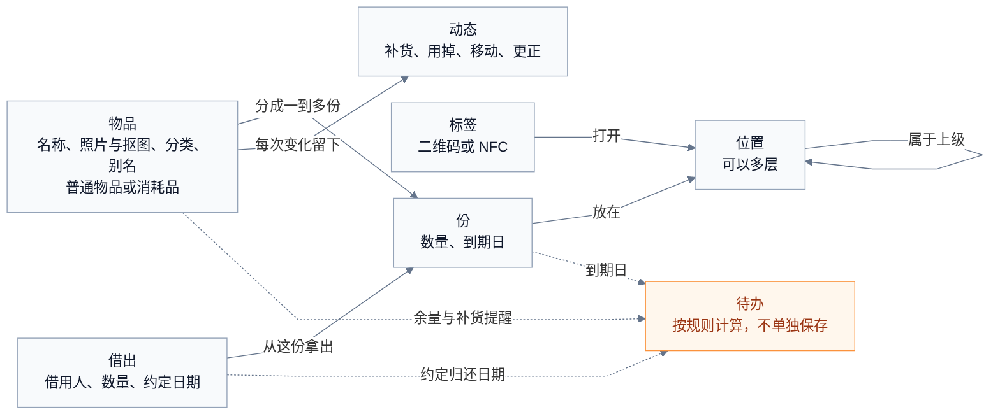
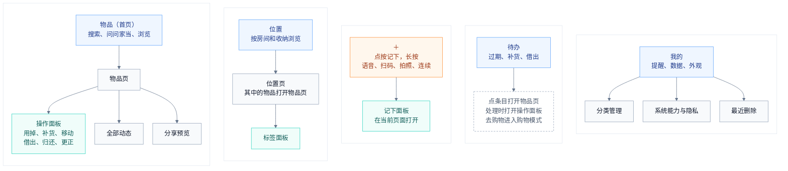
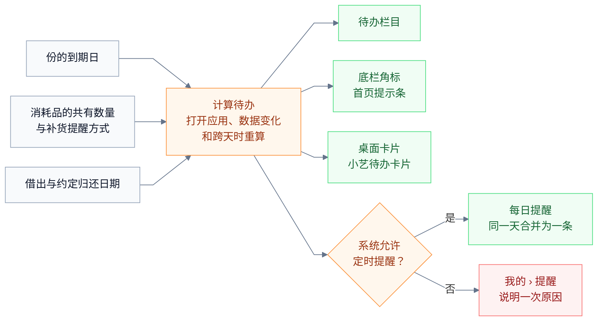

# 我的家当 · 产品说明

我的家当（ItemNest）是一款 HarmonyOS 原生的家庭物品应用，数据只保存在本机，帮用户记住东西放在哪、还剩多少、什么时候过期、借给了谁。本文描述它的产品形态：打开就能搜，也能直接问；在任何页面点一个按钮，说一句话或拍一张照，就能记下"是什么、放在哪"；日常改动在当前页面的面板里一次完成，改错了可以撤销；需要处理的事集中在"待办"。界面和入口完全依托 HarmonyOS 7（API 26）的能力：系统沉浸材质与光效、悬浮玻璃底栏、端侧 AI、小艺与智能体、实况窗、六种桌面卡片、碰一碰分享。

本目录的文档说明这个应用是什么、要做哪些功能、怎样实现：

| 文档 | 内容 |
| --- | --- |
| product.md（本文） | 产品定位、用户、成功标准、设计原则、概念、整体结构和边界 |
| [experience.md](experience.md) | 每个页面、面板、卡片、实况窗和小艺对话的结构与操作 |
| [design.md](design.md) | 颜色、字体、系统材质、光效、动效目录、触感、设备分级 |
| [harmonyos.md](harmonyos.md) | 使用的全部系统能力、声明与平台配置、降级方式、设备验证清单 |
| [data.md](data.md) | 数据表、业务规则 R1 至 R40、文件与备份格式 |
| [request.md](request.md) | 120 条需求、优先级、验收标准、非功能要求、里程碑 |

## 产品定位

**一句话**：记住家里每样东西在哪。

**它回答四个问题**：东西在哪？还剩多少？过期没有？在谁手里？

**主要用户**：

- 家里负责收纳和采购的人，经常被家人问"X 放哪了"。
- 囤货和消耗品多的人，关心余量和保质期。
- 用收纳箱、贴标签整理的人。
- 常把书、工具、户外装备借给别人的人。
- 正在搬家或大整理的人，几天内要记下几十上百件东西。

**体验目标**：找得快、记得轻、提醒准；界面有原生的质感和动效；系统里处处能用（小艺、卡片、实况窗、碰一碰）；AI 在本机帮忙认东西、听懂话、回答问题。

## 使用场景

| 场景 | 用户此刻在想 | 大致频率 | 应用怎么做 |
| --- | --- | --- | --- |
| 找东西 | "护照放哪了？" | 每周多次 | 首页就是搜索框；也可以问小艺、用桌面卡片搜，或者直接问"护照在哪" |
| 收好后记一笔 | "充电器放书房抽屉了" | 每周几次 | 长按＋说一句话，或点＋输名称、点一个最近位置 |
| 大整理、搬家 | "这一箱有 20 样东西" | 偶尔，一次几十件 | 一拍多件，或在位置页连续记下；离开应用时实况窗显示进度；给箱子打印标签 |
| 开箱前想知道内容 | "这箱是冬衣还是被子？" | 偶尔 | 扫箱子上的二维码或碰 NFC 标签，直接看到清单 |
| 消耗品用掉和买回 | "纸巾还有几包？" | 每周 | 桌面卡片上点"用掉 1"；去超市时开购物模式，锁屏就能看清单 |
| 到期 | "感冒药过期没？" | 每月 | 到期前每天一条合并提醒；在待办里一键处理 |
| 借出 | "电钻借给谁了？" | 每月 | 借出时点一下借用人；待办按人列出，过了约定日期提醒要回 |
| 随口一问 | "家里还有电池吗？" | 随时 | 问问家当用端侧模型回答，并列出依据的物品 |

## 成功标准

下面的任务在真机上按步骤走查。点击次数不含输入文字和说话，长按算一次；"回到原处"指回到开始操作时的页面和滚动位置。

| 编号 | 任务 | 目标 |
| --- | --- | --- |
| T1 | 找到一件已记下物品的位置 | 点搜索框、输入关键词即看到位置：1 次点击 |
| T2 | 记下一件新物品，位置是最近用过的 | 3 次（＋、位置候选、记下），完成后回到原处 |
| T3 | 一件消耗品用掉 1 个 | 2 次（长按、用掉 1），不离开列表，可撤销；在桌面卡片上 1 次 |
| T4 | 把物品借给以前借过东西的人 | 3 次（借出、借用人候选、确认），不用打字 |
| T5 | 收回一笔借出 | 1 次（已归还），可撤销 |
| T6 | 买回购物清单上的东西，数量和位置同上次 | 2 次（已买到、和上次一样） |
| T7 | 处理一份已过期的消耗品 | 1 次（处理掉），可撤销 |
| T8 | 查看收纳箱里有什么 | 扫标签或碰 NFC，直接打开该位置 |
| T9 | 把一个抽屉里的东西逐件记下 | 每件只需输入名称，再点 1 次 |
| T10 | 找回误删的物品 | 在提示条上撤销：1 次；30 天内可从"最近删除"恢复 |
| T11 | 换手机后找回数据 | 通过系统换机迁移或自动备份恢复，不依赖事先手动导出 |
| T12 | 说一句"两盒牛奶放冰箱，下周五到期"记下 | 长按＋选语音、说话、点记下：3 次点击，名称、数量、位置、到期日都已预填 |
| T13 | 问"家里还有电池吗" | 输入或说出问题后得到一句话回答，下方列出依据的物品 |
| T14 | 在超市看购物清单 | 点"去购物"后，锁屏和通知中心就能看到未买的项目和进度 |
| T15 | 拍一张抽屉照片记下多件物品 | 拍照后点选物品框，每件只需输入名称 |

此外，应用满足五项结构检查：

- 界面文字统一使用下文术语表中的用词，不出现数据表名、字段名这类内部概念。
- 用掉、补货、移动、借出、归还、更正数量都在当前页面的面板里完成，不推入新页面。
- 物品页不滚动就能看到位置、消耗品的在手数量和主要操作。
- 系统通知、实况窗、卡片、小艺任何一项不可用时，应用内的搜索、待办和记下照常完整。
- 底栏、标题栏、搜索框、面板、菜单、提示条都使用系统沉浸材质，动效按 design.md 的目录实现，并在低算力设备和"减少动画"下按规定降级。

## 核心做法

应用按"先找到、再记下、其余按需"组织，并把每一步交给最合适的系统能力。首页是可以直接输入的搜索框，按名称、别名、位置、拼音和条码匹配，问句交给端侧问答模型组织回答。底栏中间的＋在任何页面打开同一个记下面板：只有名称必填，位置从最近用过的候选或层级选择器里点选；也可以长按＋说一句话、拍一张照（自动抠图、识别包装文字和条码）、一拍多件或连续扫码。物品分为普通物品和消耗品：普通物品只显示位置和借出，消耗品才显示余量、用掉、补货和补货提醒。日常操作在当前页面的玻璃面板中完成，完成后出现带"撤销"的提示条，不先弹确认框。需要处理的事由待办统一计算，通过角标、卡片、每日合并提醒和购物实况窗送到用户眼前，任何一个渠道失效都不影响应用内的完整性。

## 设计原则

1. **先能找到。** 找东西是最频繁、价值最高的时刻。首页就是搜索框，结果里位置的醒目程度仅次于名称；桌面卡片、小艺、系统搜索都能直接找。
2. **只问必要的问题。** 记下一件物品只需要名称；位置建议填写，但可以先空着。其余信息都是选填，点哪项展开哪项。
3. **用默认值替用户做决定。** 连续记下时沿用上一个位置，用掉时从最早到期的一份扣，补货时照上次预填，分类按名称推荐。默认值始终可见、可改。
4. **就地完成。** 常用操作在底部面板里完成，结束后用户还在原来的页面和滚动位置。
5. **先做后撤销。** 能撤回的操作直接执行，提示条上给"撤销"；只有撤不回的操作（用备份覆盖当前数据、永久删除）才先确认。
6. **说用户的话。** 界面说"放在 2 处""在手 3 盒""借给小王"这样的日常用语。
7. **按物品的性质显示。** 护照不需要"用掉 1 个"，纸巾需要。
8. **原生的质感。** 玻璃、光效、动效、触感全部用系统能力实现，动效只表达状态变化；低算力设备和"减少动画"下自动降级。
9. **AI 帮忙，用户拍板。** 识别、语音解析、问答都在本机运行，结果只作候选或回答，写入数据前由用户确认。
10. **系统能力是入口，不是依赖。** 小艺、卡片、实况窗、通知都是入口和渠道，不可用时应用内依然完整。
11. **数据属于用户。** 不注册、不联网；删除可以找回，备份自动进行，换手机可以迁移。

## 概念与术语

借出和归还也出现在物品的动态里。完整的表结构见 [data.md](data.md)。

| 界面用词 | 含义 |
| --- | --- |
| 物品 | 一样东西，可以有多件，例如"5 号电池" |
| 位置 | 存放的地方，可以多层，显示为"卧室 › 衣柜 › 上层" |
| 份 | 同一物品放在同一位置、到期日相同的若干件；一件物品可以分几份放 |
| 在手 | 现在家里拿得到的数量 |
| 借出 | 借给别人、还没还回来的数量 |
| 共有 | 在手加借出 |
| 借用人 | 借过东西的人，借出时可以点选 |
| 消耗品 | 记录余量、用掉和补货的物品；其余是普通物品 |
| 补货提醒 | 用完时，或少于设定数量时，物品进入购物清单 |
| 到期提醒 | 到期前若干天，每天合并提醒一次 |
| 待办 | 已过期、快到期、该还了、要补货和借出未还的事项 |
| 购物清单、购物模式 | 待办里"要补货"的部分；"去购物"后逐项勾选，锁屏可见 |
| 动态 | 物品的记下、补货、用掉、过期处理、移动、更正、借出、归还记录 |
| 标签 | 贴在收纳箱上的二维码或 NFC 贴纸，扫一下打开对应位置 |
| 抠图封面 | 从照片中分割出的去背景主体图，作为物品封面 |
| 连续记下 | 一次记下多件物品，位置等信息自动沿用 |
| 问问家当 | 用自然语言提问，由端侧模型根据应用查出的事实回答 |
| 最近删除 | 删除后保留 30 天、可以恢复的物品 |
| 记下 | 新建物品的动作，也是新建面板的名称 |

## 普通物品与消耗品

家里的东西大多只需要记住在哪：证件、工具、电器、季节衣物。少数东西会被用掉、需要补买：药、食品、纸巾、洗护用品、电池。应用用一个"消耗品"开关区分两类：

| | 普通物品 | 消耗品 |
| --- | --- | --- |
| 列表右侧 | 不显示数量；多于 1 件时显示"×3" | 在手数量；用完时显示"用完了" |
| 物品页主要操作 | 移动、借出；有借出时增加归还 | 用掉 1、补货、移动 |
| 补货提醒、购物清单 | 不参与 | 参与 |
| 到期日 | 可以有（证件有效期、保修期），到期时提醒更新日期 | 可以有，到期时提醒用掉或处理 |

新建时按分类给出默认值：药品、食品、生活用品默认是消耗品，其余默认是普通物品。记下面板和物品页都显示这个开关，随时可以切换；切换只改变显示和可用操作，数据都保留。

## 信息架构

图中蓝色是底栏栏目，橙色的＋不是栏目，灰色是推入式页面，青色是在当前页面上打开的面板，虚线框是说明。底栏是悬浮在内容上的玻璃胶囊，有五个位置：

- **物品**（首页）：顶部是可以直接输入的搜索框（带麦克风和扫码），下面是待办提示条、筛选和物品列表。找东西、问问题、浏览都在这里。
- **位置**：按房间、家具、收纳箱逐层浏览，看每个位置里有什么，在这里记下物品、管理标签。
- **＋**：不是栏目，点击后在当前页面打开记下面板；长按弹出语音、扫码、拍照、连续四个快捷项。
- **待办**：已过期、快到期、该还了、要补货、借出未还，带角标；从这里进入购物模式。
- **我的**：提醒、数据（备份、自动备份、最近删除）、分类、系统能力与隐私、外观、关于。

推入式页面只有 7 个：物品页、位置页、全部动态、分享预览、分类管理、系统能力与隐私、最近删除。其余都是面板或栏目内的状态。

## 待办与提醒

待办不单独保存，打开应用、数据变化和跨天时按规则重新计算，口径见 [data.md](data.md) 的 R22、R23。同一份结果送到待办栏目、底栏角标、首页提示条、桌面卡片、小艺待办卡片和每日提醒。前五个由应用自己显示或刷新；每日提醒还取决于通知授权和代理提醒资格，任何一项不满足时，提醒不发，其余渠道照常显示，"我的 › 提醒"里说明一次原因。到期提醒在用户第一次给物品填写到期日时询问是否开启。

购物清单是待办里"要补货"的部分。"去购物"后进入购物模式，逐项勾选，购物实况窗在锁屏和通知中心显示未买的项目和进度，结束时一起补货。

## 本地 AI

所有 AI 能力都用设备上的模型，不联网，结果只作候选或回答（R35、R36）。设备不支持某项能力时，对应入口不显示。

| 能力 | 用在哪里 |
| --- | --- |
| 包装文字识别 | 拍照后给出名称、到期日候选，能从生产日期和保质期推算到期日 |
| 主体分割 | 自动生成去背景的抠图封面，列表、物品页、卡片都用它 |
| 物体检测 | 一拍多件：一张照片框出多件物品，一次记下 |
| 以文搜图 | 按"红色盒子"这类外观描述找物品照片 |
| 文档扫描、图像分析 | 扫描说明书和保修卡；在大图里选取文字或主体 |
| 语音识别、文本分析 | 一句话记下、查找和操作，抽取日期和人名 |
| 端侧问答、语音朗读 | 问问家当：用自然语言提问，模型根据应用查出的事实回答，可以朗读 |

## 系统入口

| 入口 | 用户动作 | 打开什么 |
| --- | --- | --- |
| 桌面卡片（六种） | 找东西、看待办、看借出、看某个位置、看某件物品、消耗品"用掉 1" | 应用对应页面或面板；"用掉 1"直接生效、可撤销 |
| 实况窗（三种） | 备份恢复、连续记下、购物 | 通知中心、胶囊、锁屏显示进度或清单 |
| 小艺 | "护照在哪""家里还有纸巾吗""记一下……""用掉一包纸巾""看看待办" | 查询直接回答；修改类打开预填面板由用户确认；待办直接显示卡片 |
| 智能体 | 在小艺里和"我的家当"智能体对话 | 查询和生成待确认的改动 |
| 小艺建议 | 系统根据常用操作推荐，例如晚上推荐"看看待办" | 对应页面 |
| 系统搜索 | 搜物品名 | 物品页 |
| 二维码、NFC 标签 | 扫描、碰一碰 | 位置页 |
| 每日提醒 | 点通知 | 单件物品打开物品页，多件打开待办 |
| 系统分享（接收） | 把照片或文字分享到我的家当 | 预填的记下面板 |
| 系统分享（发出）、碰一碰 | 分享物品、位置清单、借出清单、购物清单 | 先预览，再发送或碰一碰 |
| 跨设备（后续版本） | 平板用手机拍照；手机记到一半到平板继续 | 记下面板 |

## 里程碑

开发分四个里程碑，每个里程碑结束时按成功标准走查对应任务：

1. **骨架与质感**：数据层与全部规则、系统材质与动效、悬浮底栏、记下面板、查找、位置、物品页、数量操作、包装文字识别。
2. **日常闭环**：借出与归还、待办与购物清单、每日提醒、最近删除、分享、提醒与隐私设置。
3. **系统与 AI**：抠图、一拍多件、语音、问问家当、六种卡片、三种实况窗、小艺与智能体、意图共享、碰一碰、标签与 NFC。
4. **数据安全与打磨**：备份恢复、自动备份、系统换机、宽屏与拖放、首次使用、状态保存。

各里程碑包含的需求编号和完成条件见 [request.md](request.md)。
