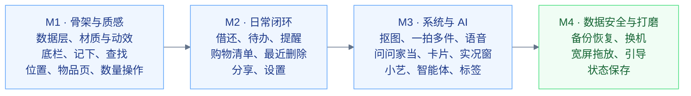

# 我的家当 · 需求说明

本文列出应用的全部功能需求和验收标准，作为实现和验收的依据。产品定位和成功标准见 [product.md](product.md)，页面细节见 [experience.md](experience.md)，视觉与动效见 [design.md](design.md)，系统能力见 [harmonyos.md](harmonyos.md)，数据模型与业务规则（R1 至 R40）见 [data.md](data.md)。

## 约定

- **编号**：NAV 结构与通用、VIS 视觉与动效、FIND 查找、CAP 记下、PLACE 位置与标签、ITEM 物品页、STOCK 数量操作、LEND 借出与归还、TODO 待办与提醒、AI 本地智能、SYS 系统入口、DATA 数据安全、SET 我的与设置、TEXT 文案。成功标准里的任务用 T 编号，定义在 product.md。
- **优先级**：P0 是首个正式版必须具备的；P1 在首个正式版中完成，进度不允许时可以推迟到下一版；P2 在后续版本中完成。
- **验收口径**：点击次数不含输入文字和说话，长按算一次；"回到原处"指回到开始操作时的页面和滚动位置。

| 模块 | P0 | P1 | P2 | 合计 |
| --- | --- | --- | --- | --- |
| NAV 结构与通用 | 3 | 6 | 0 | 9 |
| VIS 视觉与动效 | 5 | 3 | 0 | 8 |
| FIND 查找 | 4 | 5 | 1 | 10 |
| CAP 记下 | 8 | 5 | 0 | 13 |
| PLACE 位置与标签 | 4 | 4 | 1 | 9 |
| ITEM 物品页 | 8 | 0 | 1 | 9 |
| STOCK 数量操作 | 6 | 1 | 0 | 7 |
| LEND 借出与归还 | 3 | 2 | 3 | 8 |
| TODO 待办与提醒 | 7 | 3 | 1 | 11 |
| AI 本地智能 | 2 | 6 | 2 | 10 |
| SYS 系统入口 | 5 | 4 | 1 | 10 |
| DATA 数据安全 | 4 | 2 | 0 | 6 |
| SET 我的与设置 | 5 | 1 | 0 | 6 |
| TEXT 文案 | 2 | 1 | 0 | 3 |
| 合计 | 66 | 43 | 10 | 119 |

## NAV 结构与通用

### NAV-01 悬浮底栏 · P0

底栏是悬浮在内容上的玻璃底栏，五个位置依次为"物品、位置、＋、待办、我的"，应用启动后停在"物品"。＋不是栏目：点击在当前页面打开记下面板，长按弹出"语音、扫码、拍照、连续"四个快捷项。

- 使用 `Tabs.barFloatingStyle`：三档宽度、材质 G1、开启左右手适配；键盘弹出时隐藏。
- 在任一栏目点＋，记下面板在当前页面打开，所在栏目不变；动效 M02、M03、M04。
- 待办位置显示角标（R23）。

### NAV-02 面板通则 · P0

记下、选位置、选分类，以及 STOCK、LEND、TODO 中的操作，都在当前页面的底部面板里完成，不推入新页面。

- 面板关闭后，页面和滚动位置与打开前相同。
- 返回键和下滑只关闭面板；面板内的二级视图（例如选位置）在同一面板内切换，不叠加第二层。
- 面板使用材质 G3，动效 M14、M15。

### NAV-03 提示条与撤销 · P0

能撤回的操作完成后，底栏上方显示提示条（`HdsSnackBar`）：结果文字、"撤销"，需要时加"查看"。

- 显示 5 秒，读屏开启时 10 秒并可被读屏聚焦；新提示条替换旧的。
- 撤销按 R16 核对，无法撤销时说明原因；动效 M16、M17。
- 覆盖记下、补货、用掉、过期处理、移动、更正、借出、归还、资料编辑、删除、批量操作。

### NAV-04 多选与批量 · P1

物品列表、搜索结果、位置页支持多选，批量"移动到、设分类、分享、删除"。

- 长按菜单和页面菜单都能进入多选；批量操作在一个事务里完成，提示条可以整体撤销。

### NAV-05 宽屏布局与拖放 · P1

平板和展开的折叠屏上，物品栏目显示"列表｜物品页"两栏，位置栏目显示"位置树｜位置页"两栏，侧栏使用 `HdsSideBar`。

- 在列表里点另一件物品，右栏切换，左栏的滚动位置和筛选不变。
- 可以把物品拖到左侧位置树的某个位置上完成移动（动效 M28），提示条可撤销。

### NAV-06 首次使用 · P1

首次启动依次显示欢迎、选房间、记下第一件三屏，每屏可以跳过，内容见 experience.md"首次使用"。

- 欢迎屏提供"从备份恢复"。
- 引导期间不请求任何权限。

### NAV-07 状态保存与恢复 · P1

应用在后台被系统回收后再打开，回到原来的栏目、页面、滚动位置和未保存的输入（用 `NavDestination.onSaveState`、`onRestoreState`；记下面板另有草稿，见 CAP-08）。

### NAV-08 键盘快捷键 · P1

连接键盘时：Ctrl+F 聚焦搜索框，Ctrl+N 打开记下面板，Esc 关闭面板，Ctrl+Z 撤销最近一次操作（提示条还在时）。

### NAV-09 一次性提示 · P1

长按菜单、连续记下、下拉唤起这类不显眼的操作，在用户第一次用得上时提示一次（例如列表里有 3 件以上物品时提示"长按物品，可以直接用掉、移动或借出"），点"知道了"后不再出现。

## VIS 视觉与动效

### VIS-01 系统材质 · P0

底栏、标题栏、搜索框、面板、菜单、弹窗、提示条、＋按钮按 design.md 的 G1 至 G5 使用系统沉浸材质。

- 在 `module.json5` 声明应用级材质开启；标题栏滚动时渐进模糊（M05）。
- 玻璃层上的文字对比度不低于 4.5:1。

### VIS-02 光效 · P1

卡片、按钮、列表行按 design.md 的 P1 至 P3 使用点光源和按压光影；识别、问答、语音使用 P4 流光；"物品"栏目顶部有 P5 背景光晕；扫码使用 P6 扫光。

- 持续光效同时只运行一个，页面不可见时停止。

### VIS-03 动效 · P0

实现 design.md 动效目录 M01 至 M33，弹簧参数用 S1 至 S5。

- M01 至 M20、M25、M27 随首个里程碑实现，其余随对应功能实现。
- 动效可以被新操作打断；有手势的动效全程跟手。

### VIS-04 触感 · P1

按 design.md 的 H1 至 H7 在对应时刻触发系统振动预设，跟随系统触感开关。

### VIS-05 减少动画与无障碍 · P0

系统"减少动画"开启时，按动效目录"减少动画时"一列表现；读屏、大字号、状态表达按 design.md"无障碍"一节。

- 所有可操作元素有读屏文字；触控区域不小于 44vp × 44vp。

### VIS-06 设备分级 · P0

按 `uiMaterial.getGlobalMaterialLevel()` 和 `isImmersiveMaterialSupported()` 区分精致、柔和、流畅三档，按 design.md"设备分级"开关效果。

### VIS-07 形象动画 · P1

两位整理小伙伴的动画用于启动（M01）、引导、空状态、AI 思考中、全部完成（M26），随用户选择的形象切换。

### VIS-08 颜色与深浅色 · P0

所有颜色使用 design.md 的令牌，浅色、深色两套；主题可以跟随系统或手动选择（SET-05）。

## FIND 查找

### FIND-01 首页直接搜索 · P0

"物品"栏目顶部是可以直接输入的搜索框，点击即弹出键盘，结果在列表区域实时显示，不切换栏目（T1）。

- 清空后恢复浏览状态和原来的滚动位置。
- 小艺"查找物品"、`itemnest://function/search`、桌面卡片的搜索条和 Ctrl+F 都聚焦这个搜索框。

### FIND-02 匹配范围与多关键词 · P0

按 R32 匹配名称、别名、分类、位置路径、条码和备注；空格分开的多个关键词需要同时命中。

- 搜"冰箱"能找到放在"厨房 › 冰箱 › 冷藏层"的所有物品；最近删除中的物品不出现。

### FIND-03 拼音 · P1

名称、别名和位置支持拼音全拼和首字母，例如"cdq"和"chongdianqi"都能找到"充电器"（R32）。拼音在保存时生成。

### FIND-04 排序与高亮 · P0

结果按 R32 分档排序，行内高亮命中的部分；分处存放的物品，第二行显示命中的那一处位置（动效 M07）。

### FIND-05 无结果 · P0

没有结果时显示"记下'关键词'"，点击打开预填名称的记下面板；有带照片的物品且外观搜索可用时，同时提供"按外观找"（AI-04）。

### FIND-06 扫码查找 · P1

搜索框右侧的扫码按钮：条码属于一件物品时打开物品页，属于多件时列出这几件；扫到本应用的位置标签时打开位置页；都不是时提供"记下这个条码"。

### FIND-07 最近搜索 · P1

搜索框为空且获得焦点时显示最近搜索（R33），可以一键清空。

### FIND-08 浏览筛选与排序 · P1

浏览状态提供筛选"全部、消耗品、借出中、有到期日、分类"，排序"最近动过、最近记下、名称、到期日"；选择自动记住。

### FIND-09 答案卡 · P1

只有一个结果且名称与关键词完全相同时，结果顶部显示答案卡：抠图封面、大字号位置、"移动""借出"（消耗品为"用掉 1"）两个操作。

### FIND-10 下拉唤起 · P2

在"物品"栏目顶部下拉进入搜索，继续下拉松手开始语音查找（动效 M33）。

## CAP 记下

### CAP-01 记下面板 · P0

记下面板打开即聚焦名称并弹出键盘。名称是唯一必填项；位置为空时保存为"未放位置"。

- 输入名称、点一个最近位置、点"记下"，3 次点击完成（T2）；保存后回到原处，提示条显示"已记下'名称'"和"查看""撤销"（动效 M18）。
- 名称为空时"记下"不可点；在名称框按回车等同点"记下"。

### CAP-02 位置默认值与候选 · P0

- 连续记下时沿用上一件的位置；其他情况不预选，最近用过的位置排在候选第一个（R31）。
- 候选显示最近用过的 5 个位置和"选择…"，后者在面板内打开位置选择器（PLACE-03）。
- 在位置框输入时同时按名称和拼音搜索已有位置；没有匹配时可以新建，并选择它的上级，默认顶层。用户不需要输入任何路径分隔符。

### CAP-03 选填项按需展开 · P0

照片、数量、到期、分类、备注、条码、别名排成一行，点哪项展开哪项。物品是消耗品时数量项默认展开。

- 只填名称和位置时，面板上没有其他输入框。
- 到期项下方显示"到期前 N 天提醒｜改"。

### CAP-04 照片识别候选 · P0

拍照或选图后自动识别包装文字（AI-01），名称和到期日候选以标签出现在对应输入项下方，点一下才填入（R35）；照片里有条码时同时给出条码候选。

- 拍照、点名称候选、点到期候选、点"记下"，4 次点击完成。
- 候选不覆盖用户已经输入的内容；识别失败时面板照常可用，只在照片下方说明一次。

### CAP-05 重名提示 · P0

输入的名称与已有物品去掉空格后相同，或一方包含另一方时，在名称下方列出这些物品和位置（最多 3 件）。点"是这件"关闭面板，在那件物品上打开补货面板（消耗品）或移动面板（普通物品）。扫到已有条码时同样处理。

### CAP-06 连续记下 · P0

面板顶部有"连续记下"开关。开启后每次记下只清空名称、照片、数量、到期日、备注、条码和别名，保留位置、分类、单位和消耗品开关，焦点回到名称；标题显示"本次已记 N 件"，点开可以查看，也可以删掉其中某一件（动效 M19）。

- 从位置页"连续记下"打开时已开启此模式并预填该位置；每件只需输入名称再点一次（T9）。
- 开启后离开应用，显示连续记下实况窗 LV2（SYS-08）。

### CAP-07 统一入口与预填 · P0

底栏＋及长按快捷项、位置页、搜索无结果、系统分享、小艺、智能体、桌面卡片、`itemnest://function` 的 add、scan、camera、voice 都打开同一个记下面板，按 experience.md"入口与预填"表预填。

### CAP-08 草稿 · P0

面板被下滑关闭、被外部入口打断或应用退到后台时，保存当前输入到偏好 `capture_draft`。再次打开记下面板时询问"继续记'名称'？"，选"放弃"才清除。

### CAP-09 分类推荐 · P1

按名称推荐分类：先看同名物品用过的分类，再看内置关键词表（例如名称含"药""片""胶囊"推荐药品，含"纸""电池""洗衣"推荐生活用品）。推荐的分类显示为已选中的"推荐"，可以取消；消耗品开关随分类给出默认值（R19）。

### CAP-10 单位排序 · P1

单位列表把最近用过的 3 个单位放在最前面。

### CAP-11 到期快捷项 · P1

到期日选择器旁提供"3 天后、1 周后、1 个月后、3 个月后、1 年后"。

### CAP-12 连续扫码记下 · P1

长按＋选"扫码"进入扫码记下；设备支持自定义扫码界面时可以连续扫描，每扫到一个码就加一条待确认物品（动效 M29），扫完一起进入记下面板逐件补名称和位置。条码已存在时提示补货（CAP-05）。

### CAP-13 多张照片 · P1

每件物品最多 9 张照片（R37），第一张是封面；记下面板和物品页都能添加、排序、删除。照片可以来自拍照、相册、系统分享或扫描说明书（AI-06）。

## PLACE 位置与标签

### PLACE-01 位置栏目 · P0

列出顶层位置及其物品数、下级位置数，另有"未放位置"。顶部可以按名称、路径和拼音搜索位置；右上角是"扫标签"和"新位置"。

- 物品数包含所有下级位置里的物品，不含最近删除中的物品。

### PLACE-02 位置页 · P0

显示路径导航、下级位置、本位置的物品（默认包含下级，可以切换"只看这一层"），底部是"在这里记下"和"连续记下"；菜单包含标签、分享清单、改名、移到…、合并到…、删除（动效 M27）。

- 扫标签、碰 NFC、打开 `itemnest://location/{token}` 都进入位置页（T8）。

### PLACE-03 位置选择器 · P0

记下、补货、移动、批量移动共用同一个位置选择视图：搜索、最近用过的 5 个、逐层浏览（路径导航返回）、"选当前这一级"、"在这里新建"。

- 选中一个三级位置最多 4 次点击；在"最近"里时 1 次。

### PLACE-04 位置结构 · P0

位置可以多层，同一上级下名称不重复，改名和移动按 R28 处理；拖动可以调整同级顺序。

### PLACE-05 删除与合并 · P1

按 R29 删除或合并位置。执行前说明影响，例如"12 件物品和 2 个下级位置将移到'卧室'，1 个标签将失效"，确认后执行。

### PLACE-06 常见房间 · P1

还没有位置时，位置栏目和首次使用引导提供常见房间多选，一键创建为顶层位置。

### PLACE-07 标签 · P1

位置页的标签面板中：生成二维码（预览、保存到图库、分享，图片含二维码、位置名、路径和"我的家当 · 扫一扫查看物品"）；写入 NFC（写前提示会覆盖标签原有内容，动效 M30）；查看已绑定的标签并改名、解除；扫码或读取已有标签改绑到此位置（原属其他位置时先确认）。规则见 R30。

### PLACE-08 失效标签 · P1

扫到没有关联位置的标签时，提示"这个标签没有关联位置"，并提供"绑定到…"打开位置选择器。

### PLACE-09 位置照片 · P2

位置可以有一张照片，显示在位置页顶部和位置卡片上，帮助辨认柜子和箱子。

## ITEM 物品页

### ITEM-01 首屏内容 · P0

物品页标题是物品名称。在 360vp × 780vp 的竖屏窗口中，不滚动可以看到封面（抠图优先）、名称、状态标签（已过期、快到期、借出中、要补货）、位置、消耗品的在手数量和操作栏。进入动效 M11。

### ITEM-02 在手与份 · P0

只有一份时显示一行，例如"在手 6 盒 · 储物柜"；多份时逐行显示每份的位置、在手数量和到期日（R6）。点一行打开这一份的操作：移动、用掉、更正数量、改到期日。

- 各行在手数量之和等于物品的在手数量；数量变化使用动效 M12、M13。

### ITEM-03 操作栏 · P0

物品页底部是操作栏（`HdsActionBar`），内容随物品类型变化（R18）：

- 消耗品："用掉 1、补货、移动、更多"；"更多"含借出、更正数量、补货提醒、分享、复制为新物品、删除。
- 普通物品："移动、借出、更多"；有借出未还时增加"归还"，全部借出时不显示"借出"；"更多"含更正数量、分享、复制为新物品、删除。

### ITEM-04 就地编辑 · P0

名称、分类、备注、条码、别名、单位、提前提醒天数、消耗品开关在物品页上点击即编辑，单项保存；只写被改的字段，不回写数量、位置和到期日；每次保存可以撤销。没有独立的编辑页面。

- 改单位时提示"已有数量不会换算"（R2）。

### ITEM-05 到期与提醒状态 · P0

有到期日时显示最早到期日、剩余天数和提醒状态。提醒状态只有三类：已安排（"11月13日 9:00 提醒"，到点后显示"已提醒"）；未开启（"提醒已关闭｜开启"）；发不出（一句原因和一个处理按钮）。调度中间状态不显示。

### ITEM-06 照片与大图 · P0

点封面打开大图浏览（材质 G4），左右滑动切换照片；大图中可以设为封面、更换、删除；支持图像分析时可以长按提取文字或主体（AI-05）。

### ITEM-07 消耗品开关 · P0

物品资料中有"消耗品"开关，新建时按 R19 取默认值，随时可以切换；切换只改变显示和可用操作（R18）。

### ITEM-08 动态与全部动态 · P0

物品页显示最近 5 条动态（R17），"全部"进入全部动态页。借出、归还可以在动态里纠正和撤销（LEND-03）；被撤销的动态标注"已撤销"。

### ITEM-09 复制为新物品 · P2

"更多"中的"复制为新物品"打开记下面板，预填分类、单位、位置和消耗品开关。

## STOCK 数量操作

### STOCK-01 用掉 · P0

消耗品可以在物品页操作栏、列表长按菜单、待办、答案卡和桌面卡片 W6 上直接"用掉 1"：从最早到期、在手大于 0 的一份扣减，不离开当前页面（T3）。"用掉…"面板可以选数量（1、2、5、全部，或输入）和来源份。

- 提示条显示"已用掉 1 盒，还剩 5 盒"；这次用掉让物品进入购物清单时，加"，已加入购物清单"。
- 超过在手时主按钮不可点，并用一句话说明原因（R8），触感 H4。

### STOCK-02 补货 · P0

补货面板按 R21 预填数量和位置，提供"和上次一样"一键确认；到期日选填；保存时按 R4 合并或新建一份。

### STOCK-03 移动 · P0

移动面板选择目标位置；有多份时先选移哪一份；移动后按 R4 合并。普通物品只有一份时，"移动"直接打开位置选择视图。

### STOCK-04 部分移动 · P1

移动面板可以填写移动数量，默认整份；少于整份时按 R15 拆分。

- 从"储物柜 · 4 盒"移 2 盒到冰箱后，两处各显示 2 盒，到期日不变。

### STOCK-05 更正数量 · P0

在某一份上更正数量，面板问"这里实际有几个"，按 R9 保存。物品有借出未还时，保存后借出数量不变，这一份的在手等于输入值。

### STOCK-06 撤销 · P0

记下、补货、用掉、过期处理、移动、更正都返回回执，提示条上可以撤销（R16）。撤销前这件物品又有其他数量操作时，撤销被拒绝并说明原因。

### STOCK-07 过期处理 · P0

已过期的消耗品可以"处理掉"：这一份的在手清零，动态记一条"过期处理"（`DISCARD`），提示条可以撤销（T7）。

## LEND 借出与归还

### LEND-01 借出面板 · P0

借出面板包含借给谁（最近借用人候选和输入框，R13）、数量（消耗品或在手多于 1 件时显示，默认 1）、从哪一份（有多份时显示，R10）、约定归还（LEND-04）和备注。

- 在物品页点"借出"、点一个借用人候选、点"确认"，3 次点击完成（T4）；完成后回到原处，提示条可撤销。

### LEND-02 归还 · P0

物品页、待办、借出未还分组里，每笔借出旁的"已归还"一次归还这一笔的全部未还数量，提示条可撤销（T5）；部分归还通过"归还…"面板选择数量。规则见 R11。

### LEND-03 纠正与撤销 · P0

在动态中可以纠正借出或归还的借用人、数量、约定日期和备注，或撤销一笔记录（R12）。撤销直接执行，提示条上可以恢复，不先弹确认框。

### LEND-04 约定归还日期 · P1

借出面板提供"约定归还"：不确定、1 周后、1 个月后、选日期。过了约定日期仍未还的借出进入待办"该还了"并计入角标，在提醒中一并通知（R24）；约定日期可以修改。

### LEND-05 按人汇总与提醒对方 · P1

待办的"借出未还"按借用人分组，显示件数和最早借出时间，展开后列出每一笔。"提醒对方"打开分享预览，预填可修改的提醒文字（data.md"分享文本"）。

### LEND-06 借用人管理 · P2

在借出未还分组的借用人菜单里可以改名，或合并两个借用人（例如"小王"和"王小明"）。

### LEND-07 从联系人选择 · P2

借给谁可以通过系统联系人选择器选择，只保存姓名和联系人标识。

### LEND-08 写入日历 · P2

设置约定归还日期时，可以选择同时在系统日历中添加一条"收回电钻"的日程。

## TODO 待办与提醒

### TODO-01 待办栏目 · P0

待办按"已过期、快到期、该还了、要补货、借出未还"分组显示，口径见 R22。已过期按过期天数从多到少，快到期按到期日从近到远；分组标题在滚动时悬浮。

### TODO-02 角标与提示条 · P0

底栏待办角标按 R23 计数；有待办时"物品"栏目顶部显示提示条，按紧急程度最多列三组数量，点击进入待办。同一时刻，卡片、角标和提示条的数量一致。

### TODO-03 一键处理 · P0

每条待办右侧是主要操作，左滑（`HdsListItem` 滑动操作）或长按出现其余操作，内容见 experience.md"待办"。完成后行收起，一组清空时播放 M25，全部完成时播放 M26。

### TODO-04 购物清单 · P0

"要补货"组就是购物清单。每条的"已买到"打开补货面板，"和上次一样"一键完成（T6）；"不再提醒补货"把补货提醒改为"不提醒"。顶部"分享购物清单"先预览再分享（SYS-02）。

### TODO-05 购物模式 · P1

购物清单上的"去购物"开始购物模式：逐项勾选"已买到"，结束时一起补货，可以批量按"和上次一样"确认；同时显示购物实况窗 LV3，锁屏可见未买的项目和进度（T14）。全部勾选或点"结束购物"后进入批量补货确认，确认后实况窗关闭。

### TODO-06 首次询问 · P0

第一次保存带到期日的物品后，提示条询问"到期前提醒你？［提醒我］［不用］"（R25）。选"提醒我"时请求通知授权并开启到期提醒。

### TODO-07 每日提醒 · P0

按 R24 用系统代理提醒发出每天一条的合并通知，内容见 harmonyos.md"提醒与通知"。点通知：单件打开物品页，多件打开待办。

### TODO-08 通知不可用时 · P0

通知未授权、代理提醒发布失败或平台不允许时，待办、角标、提示条和卡片照常显示全部事项；"我的 › 提醒"显示一句原因和处理方式。

### TODO-09 提醒时刻 · P1

"我的 › 提醒"可以设置每天提醒的时刻，默认 9:00；修改后重新对账提醒计划。

### TODO-10 稍后 · P1

快到期的条目可以"稍后"，到期当天再提醒；推迟期间不出现在待办、角标和卡片中（R22）。

### TODO-11 通知上的操作 · P2

每日提醒通知提供"查看"和"明天再提醒"两个按钮。

## AI 本地智能

所有 AI 能力在设备上运行，不联网；结果只作候选或回答，写入数据前由用户确认（R35、R36）。

### AI-01 包装文字识别 · P0

照片中的文字用 Core Vision Kit 文字识别，应用从中找出名称、生产日期、保质期和到期日，生成候选（CAP-04）。由生产日期和保质期推算的到期日标明"推算"；识别中播放 M21。

### AI-02 抠图封面 · P1

照片加入后用主体分割生成透明背景的抠图，作为物品封面显示在列表、物品页、答案卡和桌面卡片上（M20）。分割失败或设备不支持时用原图缩略图。

### AI-03 一拍多件 · P1

长按＋选"拍照"后可以切到"一拍多件"：拍一张抽屉或箱子的照片，物体检测框出多件物品，用户点选要记下的框（M22），每个框的裁剪图成为一件物品的照片，然后在记下面板里逐件输入名称（T15）。位置统一预填。

### AI-04 按外观找 · P1

开启照片外观搜索时，照片保存后加入以文搜图索引（R37）。搜索无结果或用户点"按外观找"时，用描述（例如"红色盒子"）检索照片，结果标注"外观相似"，与名称结果分开显示。

### AI-05 大图分析 · P2

物品大图支持图像分析：长按可以选取图中文字（如序列号）或抠出主体。

### AI-06 扫描说明书 · P1

物品页和记下面板的照片区提供"扫描说明书"，用文档扫描控件拍摄并矫正，保存为扫描件照片（`DOCUMENT`）。

### AI-07 语音记下与语音操作 · P1

长按＋选"语音"、搜索框的麦克风、记下面板的麦克风都可以说话（端侧中文识别，使用时申请麦克风权限，动效 M23）：

- 记下："充电器放书房抽屉""两盒牛奶放冰箱，下周五到期"，解析为名称、数量、位置、到期日，预填记下面板（T12）。
- 查找："护照在哪"，进入搜索并显示结果。
- 操作："用掉一包纸巾""电钻借给小王""小王把电钻还了"，打开对应物品上预填的面板。
- 解析方式见 harmonyos.md"本地 AI"；位置按名称和拼音匹配已有位置，匹配不到时作为新位置候选。

### AI-08 朗读回答 · P2

问问家当的回答卡上有朗读按钮，用系统朗读能力读出回答。

### AI-09 问问家当 · P1

在搜索框输入或说出问题（含"吗、几、哪、多少、什么"等疑问词，或用户点"问问家当"），应用先查询数据库得到相关物品、数量、位置和日期，再用端侧问答模型生成一句话回答，流式显示在答案卡上（M24），下方列出依据的物品卡片（R36、T13）。

- 能回答的问题：位置（"剪刀放哪了"）、余量（"家里还有电池吗""纸巾还剩几包"）、到期（"有什么快过期了"）、借出（"借给小王的有什么"）、位置里有什么（"药箱里有什么"）。
- 端侧问答不可用或关闭时，只显示查询结果卡片；答案卡下方提供"在小艺里继续问"（SYS-06）。

### AI-10 可用性检测与降级 · P0

每项 AI 能力在使用前检查设备支持，不支持时隐藏对应入口，不报错；"我的 › 系统能力与隐私"列出各项 AI 能力在本机是否可用。

## SYS 系统入口

### SYS-01 链接 · P0

按 data.md"链接"处理 `itemnest://item`、`location`、`function`。来自链接、NFC、通知的改动请求按 R34 先打开预填面板。

### SYS-02 分享预览 · P0

分享物品、位置清单、借出清单（按人）、购物清单、提醒对方的文字时，先在分享预览里确认内容和可选项（位置、备注、借用人、照片），再调起系统分享。格式见 data.md"分享文本"；物品分享生成带抠图封面的图片卡片。

### SYS-03 碰一碰分享 · P1

分享预览、物品页、位置页、购物清单打开时，与另一台设备碰一碰，即把当前内容（图片卡片和文字）分享过去（`harmonyShare`）。

### SYS-04 小艺意图与系统搜索 · P0

实现 harmonyos.md 的意图 I1 至 I5 和物品实体 E1；I6（在小艺里显示待办卡片）为 P1。

- 查询类意图返回以位置开头的回答；记录类意图打开预填面板，回答"已准备好，请在应用里确认"。
- "允许小艺查询与操作""允许系统搜索物品""系统搜索结果显示位置"三个开关按 R39 生效。

### SYS-05 意图共享 · P1

用户执行查找、看待办、用掉、打开购物清单后，把这次操作分享给系统，用于小艺建议；物品删除时删除相关实体；开关关闭时删除全部已分享的意图。

### SYS-06 智能体 · P1

在小艺开放平台创建"我的家当"智能体，应用提供 A2A 服务，支持查询、生成待确认改动、读取待办摘要；答案卡下方提供 `FunctionComponent` 入口"在小艺里继续问"，设备不支持时不显示。

### SYS-07 桌面卡片 · P0

实现 harmonyos.md 的六种卡片 W1 至 W6；W1 至 W3 为 P0，W4 至 W6 为 P1。

- 卡片数据与待办同一口径，数据变化、每天 00:01 和跨天时刷新；支持浅色、深色和单色主题模式。
- W6 的"用掉 1"直接记一笔，卡片上 5 秒内可撤销（R34 例外），播放越界动效 M32。
- W4 至 W6 提供卡片编辑页，选择位置、物品或消耗品。

### SYS-08 实况窗 · P1

实现 harmonyos.md 的三种实况窗：LV1 备份与恢复、LV2 连续记下、LV3 购物清单（自定义展开区和锁屏样式）。

- 用户关闭对应开关、系统不允许或平台未开通时不创建，应用内照常显示进度。

### SYS-09 接收分享 · P0

从系统分享收到的一张图片或一段文字，打开预填的记下面板；正在记下时先保存当前草稿再切换（CAP-08）。

### SYS-10 跨设备 · P2

平板上记下物品时可以用附近手机的相机拍照；手机上记到一半的物品或打开的物品页可以在平板上继续（应用接续）。

## DATA 数据安全

### DATA-01 数据库与规则 · P0

按 data.md 建立数据库 `nest.db` 和全部表，实现规则 R1 至 R40；所有写操作在事务内完成并排队执行（R14）。

- 进程在任意时刻被结束，已提交的数据完整，未提交的改动不留下半条记录。

### DATA-02 便携备份与恢复 · P0

"我的 › 数据"可以导出 `.itemnest` 备份包和从文件恢复，格式见 data.md"备份包"，流程见 R40。

- 恢复前显示预览（物品、位置、照片数量和备份时间），确认后才覆盖；覆盖前自动保存安全备份，可以在"我的 › 数据"另存。
- 超过 3 秒的操作显示进度和实况窗 LV1；申请短时任务，退到后台继续完成。
- 文件损坏、格式不对、空间不足时不改动当前数据，并说明原因。

### DATA-03 自动备份 · P1

开启自动备份时，应用在前台且距上次超过 7 天时在后台生成备份包，保留最近 3 份；"我的 › 数据"显示上次自动备份的时间和占用空间，可以导出任意一份或从中恢复。连续失败 3 次后在"我的"中提示。

### DATA-04 系统备份与换机 · P1

开启系统备份恢复，实现备份扩展：备份一致的数据库副本和照片目录；通过系统换机或系统备份恢复后，数据和照片完整，提醒重新安排（T11）。

### DATA-05 最近删除 · P0

删除物品按 R26 进入最近删除，提示条可以撤销（T10）；"我的 › 数据 › 最近删除"列出这些物品，可以恢复或永久删除；30 天后自动永久删除（R27）。物品有借出未还时，删除前确认一次。

### DATA-06 照片存储 · P0

照片按 R37 导入和处理，存放在应用沙箱；按 R38 清理孤儿文件；删除或更换照片时同步更新以文搜图索引。

## SET 我的与设置

### SET-01 "我的"页面 · P0

"我的"分为提醒、数据、整理、系统入口、外观、关于六组，结构见 experience.md"我的"。

### SET-02 提醒设置 · P0

到期提醒开关、默认提前天数（0 至 365）、提醒时刻、通知授权状态和"去开启"；提醒发不出时显示原因（TODO-08）。开关打开时请求通知授权并对账提醒计划。

### SET-03 分类管理 · P0

分类可以新增、改名（同步到已有物品）、停用和启用、调整顺序、设置"新物品默认是消耗品"。预设分类可以改名和停用，不能删除。

### SET-04 系统能力与隐私 · P0

列出并控制 data.md 偏好中的各项开关：小艺查询与操作、系统搜索物品、系统搜索显示位置、照片外观搜索、问问家当、向系统分享常用操作、三种实况窗、自动备份；同时显示各项 AI 能力在本机是否可用（AI-10）。开关效果见 R39。

### SET-05 外观 · P0

主题（跟随系统、浅色、深色）立即生效；应用图标在两种形象间切换（`bundleManager.setAlternateIcon`），切换后以系统实际使用的图标确认结果，设备不支持时说明原因。启动和空状态的形象随之切换（VIS-07）。

### SET-06 关于与帮助 · P1

使用技巧（长按、连续记下、语音、标签、卡片、实况窗的用法，配动图）、数据与隐私说明（数据只在本机、AI 在端侧运行、各开关的作用）、版本号。

## TEXT 文案

### TEXT-01 术语 · P0

界面文字使用 product.md 的术语表：同一个概念全应用只用一个说法，不出现数据表名、字段名、英文枚举值。

### TEXT-02 说明与状态文字 · P0

界面不解释内部规则。只在操作被拒绝或结果出乎意料时，用一句话说明原因和下一步；状态文字只写用户看得懂、能处理的状态；出错时，用户能处理的原因要说出来（存储空间不足、通知被关闭），其余只说没成功并给出重试。物品页、记下面板和操作面板里，常驻的说明文字每处不超过一行。

### TEXT-03 日期与数字 · P1

日期 7 天内显示"今天、明天、3 天后、过期 2 天"，更远显示"11月20日"，不在今年时加年份。数量去掉末尾多余的 0（1.50 显示为 1.5）；数字和单位之间留一个空格，例如"2 盒"。

## 通用要求

| 项目 | 要求 |
| --- | --- |
| 可靠性 | 写操作都在事务内；进程被结束时，已确认的数据和草稿不丢 |
| 隐私 | 不申请网络权限，不需要账号；照片、语音、问答都在本机处理；分享前预览 |
| 适配 | 手机、平板、折叠屏；浅色、深色；键盘避让；安全区；系统字号放大 |
| 无障碍 | 见 VIS-05 |

## 验证

- **本地单元测试**：R1 至 R40 每条规则的正常情况、主要失败和边界；搜索的匹配与排序（多关键词、拼音、别名）；语音和文字的解析；待办与角标口径；提醒计划对账；撤销回执核对；备份包校验。
- **设备测试**：数据库创建、升级和事务回滚；备份与恢复（含取消、空间不足、文件损坏）；系统备份与换机；harmonyos.md"设备验证清单"中的全部项目。
- **视觉验收**：在精致、柔和、流畅三档设备和"减少动画"开启时，逐条核对 design.md 的动效目录。
- **任务走查**：每个里程碑结束时，在真机上按 product.md 的成功标准逐项走查，记录实际点击次数。
- **术语检查**：逐页核对用户可见文字，与 product.md 术语表一致。

## 里程碑

| 里程碑 | 需求 | 完成条件 |
| --- | --- | --- |
| M1 骨架与质感 | DATA-01、DATA-06；VIS-01、VIS-03、VIS-05、VIS-06、VIS-08；NAV-01–03；FIND-01、FIND-02、FIND-04、FIND-05；CAP-01–08；PLACE-01–04；ITEM-01–08；STOCK-01–03、STOCK-05–07；AI-01、AI-10；SET-01、SET-03、SET-05；TEXT-01、TEXT-02；SYS-01、SYS-09 | T1、T2、T3、T9 达标；材质、动效、设备分级、减少动画验收通过 |
| M2 日常闭环 | LEND-01–05；TODO-01–04、TODO-06–10；DATA-05；SYS-02；SET-02、SET-04；STOCK-04；NAV-04；FIND-03、FIND-06–08；CAP-09–11；TEXT-03；VIS-04 | T4、T5、T6、T7、T10 达标；通知不可用时待办完整 |
| M3 系统与 AI | AI-02–04、AI-06、AI-07、AI-09；SYS-03–08；TODO-05；PLACE-05–08；CAP-12、CAP-13；FIND-09；VIS-02、VIS-07 | T8、T12、T13、T14、T15 达标；harmonyos.md 设备验证清单通过 |
| M4 数据安全与打磨 | DATA-02–04；NAV-05–09；SET-06 | T11 达标；product.md 的结构检查全部通过 |
| 后续版本 | FIND-10、PLACE-09、ITEM-09、LEND-06–08、TODO-11、AI-05、AI-08、SYS-10 | — |

DATA-02 是 P0，安排在 M4 是因为它要等全部数据结构稳定；首个正式版发布前必须完成。
